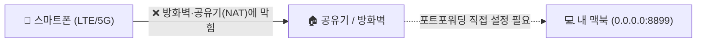
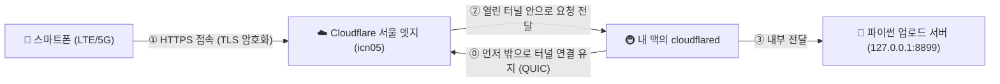
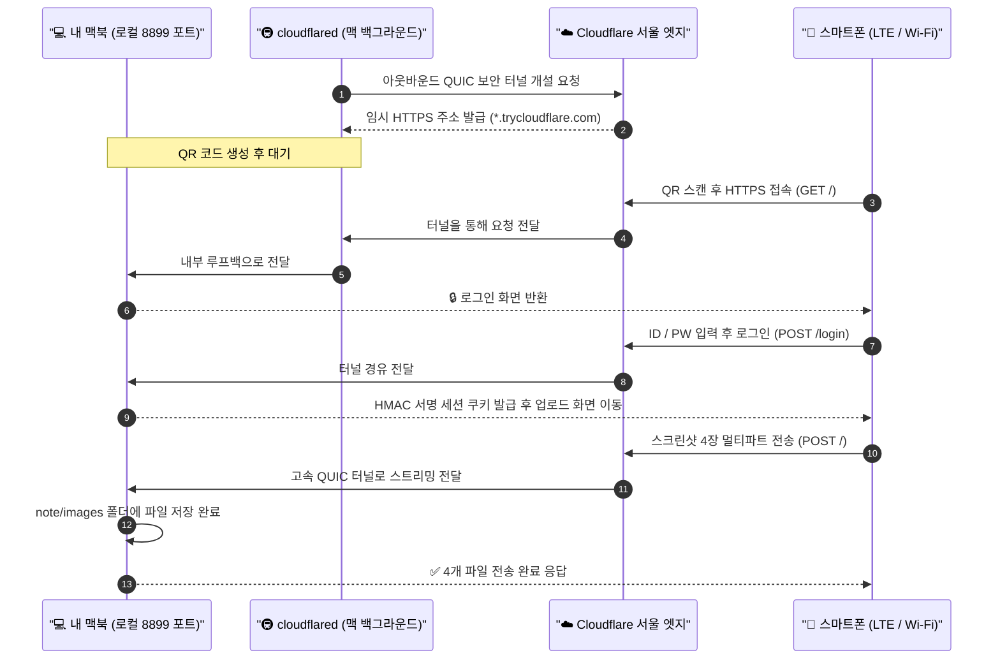

# Cloudflare Tunnel(`cloudflared`) 원리 및 활용 정리

공유기 포트포워딩이나 방화벽 설정을 전혀 건드리지 않고도, 내 맥북(`localhost`)에 띄운 작은 웹 서버를 **외부(LTE/5G 스마트폰 등)에서 안전한 HTTPS 주소로 즉시 접속**할 수 있게 해주는 **Cloudflare Tunnel**의 동작 원리와 보안 구조를 알기 쉽게 정리한 문서입니다.

---

## 1. 한 줄 핵심 요약: 왜 공유기 설정 없이 접속될까?

원래 집이나 카페 공유기(NAT) 뒤에 있는 내 맥북은 **밖에서 안으로 들어오는 문(Inbound 포트)** 이 굳게 닫혀 있습니다.

**Cloudflare Tunnel의 핵심은 '역발상(Outbound-Only)'입니다.**
밖에서 내 맥북으로 억지로 문을 부수고 들어오는 대신, **내 맥북에서 실행한 `cloudflared` 프로그램이 먼저 밖(Cloudflare 서울 서버)으로 걸어 나가 전용 비밀 통로(터널)를 연결해 둔 채 대기**합니다. 우리가 인터넷 웹서핑을 할 때 밖으로 나가는 통신(Outbound)은 공유기나 방화벽이 막지 않는다는 점을 이용한 것입니다!

---

## 2. 기존 연결 방식 vs Cloudflare Tunnel 구조 비교

### ❌ 기존 방식 (포트포워딩 / 내부 IP 직접 접속)
- 같은 Wi-Fi에 있어야만 접속되거나(내부 IP), 외부에서 접속하려면 공유기 관리자 페이지에서 **포트포워딩**을 설정하고 방화벽을 열어야 합니다.
- 내 집의 **공인 IP가 외부에 그대로 노출**되며, 통신사 환경(CGNAT 등)이나 카페·회사 공용 망에서는 아예 설정 자체가 불가능합니다.



### ✅ Cloudflare Tunnel 방식 (아웃바운드 보안 터널)
- 내 맥북의 웹 서버는 오직 자기 자신만 접속할 수 있는 **`127.0.0.1:8899`(루프백)** 에만 띄웁니다.
- `cloudflared`가 가장 가까운 **Cloudflare 서울 리전(`icn05`)** 으로 암호화된 터널(QUIC 프로토콜)을 먼저 뚫어 연결을 유지합니다.
- 스마트폰이 `https://xxxx.trycloudflare.com`으로 접속하면, Cloudflare가 이미 열려 있는 그 터널을 통해 내 맥북으로 데이터를 실어 나릅니다.



### 📊 방식별 한눈에 비교하기

| 구분 | 로컬 내부 IP (`192.168.x.x`) | 공유기 포트포워딩 | 무료 SSH 터널 (`nokey@localhost.run`) | **Cloudflare Tunnel (`cloudflared`)** |
| :--- | :---: | :---: | :---: | :---: |
| **LTE / 5G 외부 접속** | ❌ 불가 (같은 Wi-Fi 필수) | ⭕ 가능 | ⭕ 가능 | **⭕ 언제 어디서나 가능** |
| **공유기·방화벽 설정** | 불필요 (단, AP 격리 시 막힘) | 직접 설정 필수 | 불필요 | **불필요 (설정 0)** |
| **HTTPS 보안 인증서** | ❌ 없음 (`http://`) | 직접 발급 필요 | ⭕ 자동 적용 | **⭕ 자동 적용 (`https://`)** |
| **내 공인 IP 숨김** | 내부망 한정 | ❌ 공인 IP 노출 | ⭕ 숨김 | **⭕ 완벽 숨김** |
| **주소 유지 안정성** | 고정 | 유동 IP 바뀔 수 있음 | ⚠️ **2~3분마다 주소 바뀜 (`no tunnel`)** | **✅ 켜두는 동안 주소 절대 안 바뀜** |
| **파일 전송 속도** | 매우 빠름 | 빠름 | 보통 (해외 경유) | **매우 빠름 (서울 `icn05` 엣지 직결)** |

---

## 3. 스마트폰 사진이 내 맥북에 도착하기까지의 실제 흐름

오늘 스마트폰에서 QR 코드를 찍어 마등 천하통일 스크린샷을 맥북으로 보낼 때, 뒤에서는 아래 순서대로 통신이 일어났습니다.



---

## 4. 외부 URL인데 남이 들어오면 어떡하지? (4중 안전장치)

외부에서 접속 가능한 주소가 생긴다고 하면 보안이 걱정될 수 있지만, 아래 구조로 조합하면 매우 안전하게 일회성 전송용으로 쓸 수 있습니다.

1. **맥북 포트 완전 은폐 (`127.0.0.1` 바인딩)**
   - 파이썬 서버를 `0.0.0.0`(모든 네트워크 허용)이 아닌 **`127.0.0.1`(내 맥북 내부 전용)** 로 띄웠기 때문에, 설령 카페 공용 Wi-Fi에 해커가 같이 접속해 있어도 내 맥북의 `8899` 포트는 아예 보이지도 않고 열리지도 않습니다. 오직 내 맥 안의 `cloudflared`만 이 서버와 대화할 수 있습니다.
2. **집 공인 IP 완벽 보호 & DDoS 방어**
   - 외부에는 Cloudflare 서버의 IP만 보일 뿐, 내 집 공유기의 실제 IP 주소는 어디에도 드러나지 않습니다.
3. **전 구간 암호화 (`HTTPS` + `QUIC`)**
   - 스마트폰 ↔ Cloudflare 구간은 표준 **HTTPS(TLS)** 로 암호화되고, Cloudflare ↔ 내 맥북 구간은 차세대 전송 프로토콜인 **QUIC 암호화 터널**로 보호됩니다.
4. **ID/PW 로그인 + 작업 직후 터널 파기 (On-Demand)**
   - 무작위 영어 단어 4개 조합(`xxxx-xxxx-xxxx-xxxx.trycloudflare.com`)을 제3자가 추측하기도 어렵지만, 설령 주소를 알더라도 **ID/PW 인증(HMAC-SHA256 서명 쿠키)** 없이는 화면조차 볼 수 없습니다.
   - 무엇보다 **사진 전송이 끝나자마자 서버와 터널 프로세스를 바로 종료(`kill`)** 해버리므로, 문 자체가 지구상에서 사라집니다.

---

## 5. 알아두면 좋은 두 가지 모드

Cloudflare Tunnel은 상황에 따라 두 가지 방식으로 쓸 수 있습니다.

### ① Quick Tunnel (오늘 사용한 방식 · 무계정 즉석 터널)
- **특징:** Cloudflare 회원가입이나 로그인 없이 `cloudflared tunnel --url http://127.0.0.1:8899` 명령어 한 줄로 즉시 실행됩니다.
- **도메인:** 실행할 때마다 `https://랜덤단어4개.trycloudflare.com` 형태의 일회용 주소가 무료로 발급됩니다.
- **추천 용도:** 폰↔맥 파일 전송, 개발 중인 웹페이지 모바일 화면 테스트, 친구에게 잠깐 내 로컬 프로젝트 보여주기, 외부 웹훅(Webhook) 수신 테스트

### ② Named Tunnel (고정 도메인 터널 · 무료 계정 연동)
- **특징:** Cloudflare 무료 계정에 내 개인 도메인(예: `mydomain.com`)을 등록해 두면, `https://upload.mydomain.com`처럼 **영구 고정된 내 주소**로 터널을 연결할 수 있습니다.
- **보너스 기능 (Zero Trust Access):** 내 코드에 로그인 기능을 직접 짤 필요 없이, Cloudflare 앞단에서 **"내 구글 계정이나 이메일 인증번호(OTP)를 통과한 사람만 내 서버에 접근 허용"** 같은 강력한 기업용 인증 화면을 무료로 덧씌울 수도 있습니다.

---

## 6. 터미널 수동 실행 치트시트

나중에 직접 터미널에서 띄워보고 싶을 때 바로 쓸 수 있는 요약 명령어입니다.

```bash
# 1) 터미널 탭 1: 로컬 전용(127.0.0.1) 인증 업로드 서버 실행
python3 ~/.gemini/config/skills/phone-file-upload/scripts/upload_server.py \
  --dir "/Users/taehun/note/images" \
  --host 127.0.0.1 \
  --port 8899 \
  --user "taehun" \
  --password "원하는비밀번호"

# 2) 터미널 탭 2: Cloudflare 외부 HTTPS 터널 연결
~/.gemini/config/skills/phone-file-upload/scripts/cloudflared tunnel \
  --url http://127.0.0.1:8899 --no-autoupdate

# 3) 출력된 https://xxxx.trycloudflare.com 주소를 QR로 변환해 스캔 후 사용!
# 다 쓴 뒤에는 두 터미널에서 Ctrl + C 를 누르면 즉시 모든 통로가 닫힙니다.
```
