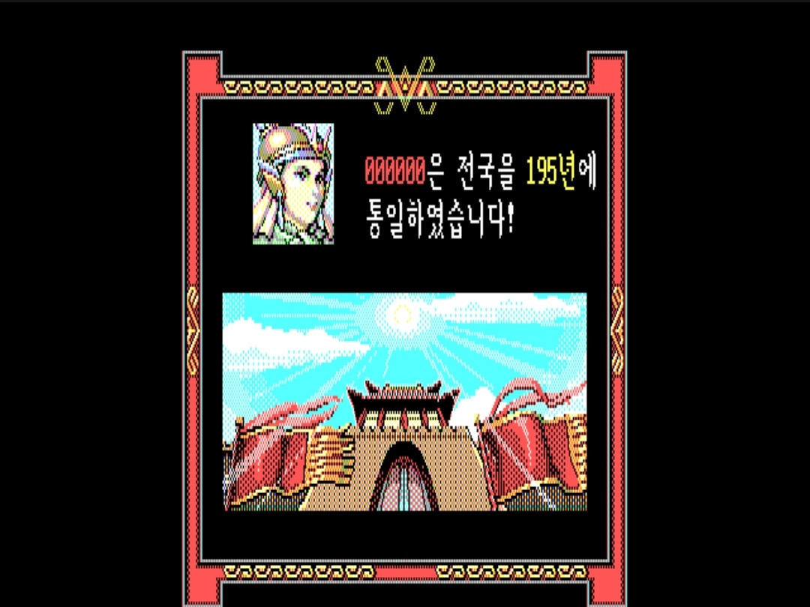
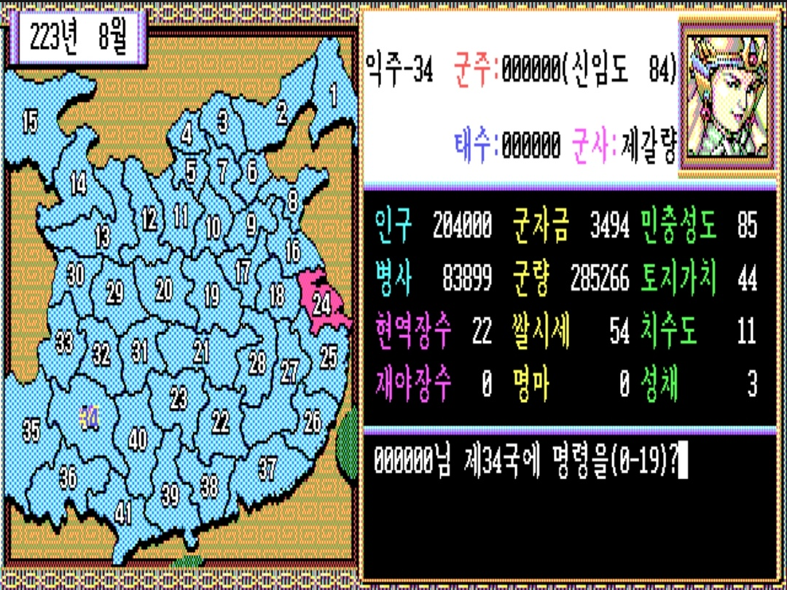
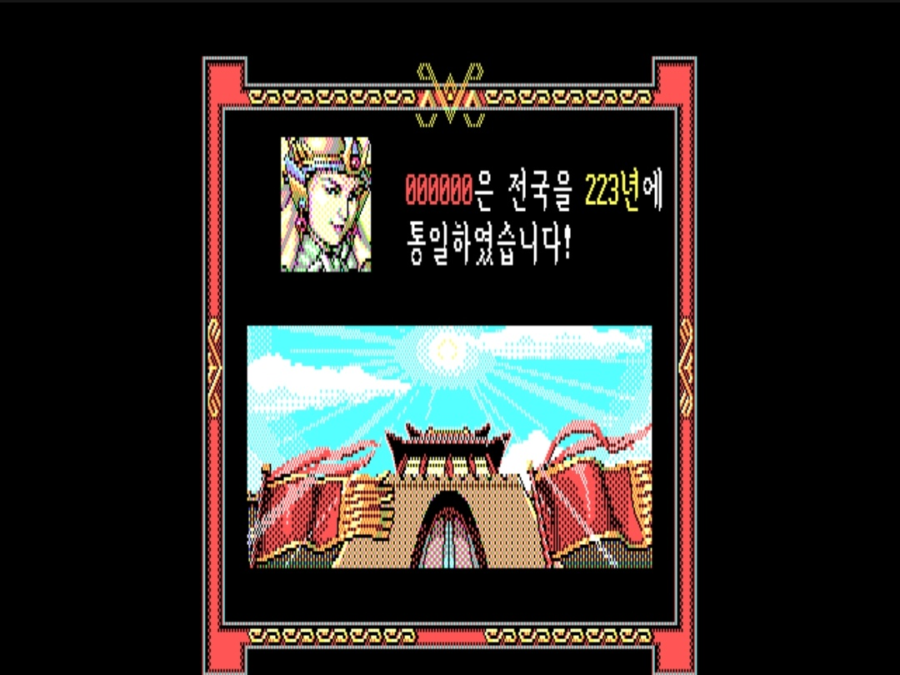
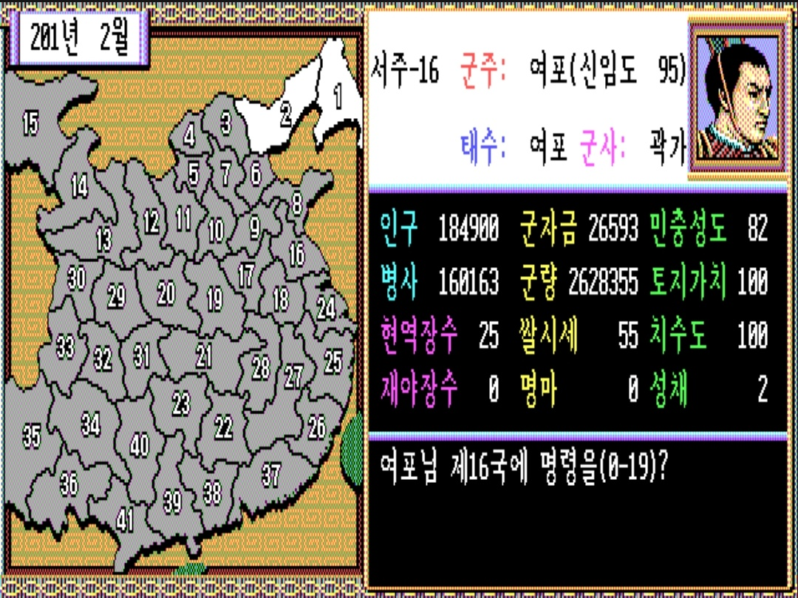
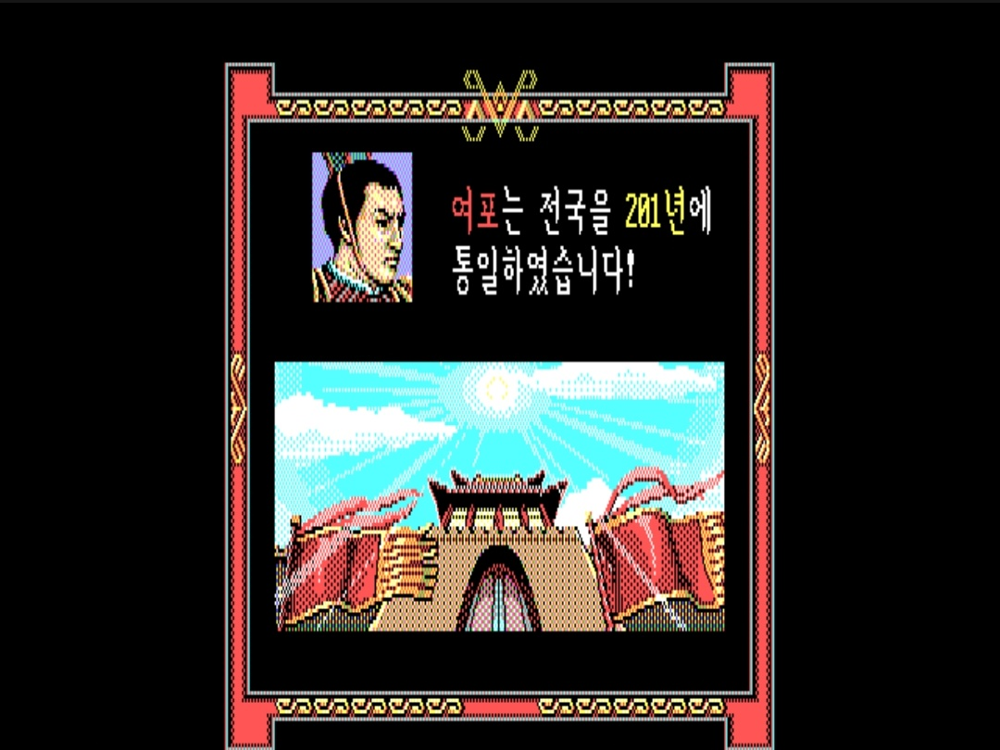

# 삼국지 2 플레이 메모 & 공략 정리

직접 플레이하면서 정리한 **삼국지 2 핵심 공략 팁(초반 무장도 러시, 낙양 보물 파밍, 적중작적 활용법, 신용도 관리)** 과 **천하통일 플레이 기록**입니다.

---

## 1. 핵심 공략 & 꼼수 정리

### ① 초반 가성비 '무장도 100' 러시 (병력 3,000 + 금 30)
- **초반 AI의 약점:** 시작 시점에는 상대 장수들의 **무장도**가 매우 낮습니다.
- **가성비 병력 세팅:** 무력 90 이상(안 되면 80 이상이나 70 이상) 장수를 확보한 뒤, 굳이 병력을 1만 명까지 다 채울 필요 없이 **병력 3,000명** 정도로 맞춥니다.
- **무기 구매 공식:** 상인에게 무기를 살 때 통상 **금 100 = 무기 10,000** 비율이므로, **금 30이면 무기 3,000**을 사서 **병력 3,000명의 무장도를 100%** 로 만들 수 있습니다.
- 이렇게 **무장도 100을 채운 장수 3~5명**만 만들어서 곧바로 이웃 땅으로 쳐들어가면 초반 영토 확장이 매우 수월합니다.

---

### ② 지력 100 군사 만들기 & 10번 낙양(洛陽) 100% 보물 파밍
삼국지 2에서는 **지력 100을 맞추면 등용·계략 조언을 100% 신뢰할 수 있어 게임이 사실상 끝납니다.** 하지만 기본 지력 100인 장수는 **제갈량** 딱 한 명뿐이라, 보물을 파밍해 지력을 올려야 합니다.

- **10번 낙양 땅의 비밀:** 보물은 다른 땅에서도 확률적으로 나오지만, **10번 낙양 땅을 공격해서 점령하면 100% 확률로 보물이 등장**합니다.
- **지력 보물 노가다:**
  - 이미 지력 100인 군사가 있다면 `적중작적` 등으로 낙양을 계속 쉽게 먹으며 보물을 무한 파밍할 수 있습니다.
  - 지력 100 군사가 없더라도 낙양을 전쟁이나 `적중작적`으로 점령할 때 **세이브/로드**를 반복해 **지력을 올려주는 책(병법서)** 이 나올 때까지 노가다하면 지력 100 군사를 만들 수 있습니다.
- **보물 종류별 효과 정리:**
  - 📘 **책(서적):** 지력 상승
  - ⚔️ **무기:** 무력 상승
  - 💃 **미녀(소교·대교 등):** 매력 상승
  - 👑 **옥새:** 군주 매력 100 & 신용도(신임도) 100
  - 🐎 **명마:** 전투 퇴각 시 절대 잡히지 않는 능력
  - 💊 **청낭서:** 부상·질병 항상 치료
  - 💡 **보물 수여 공통 효과:** 장수에게 보물을 주면 그 장수의 **충성도는 무조건 100**이 됩니다!

---

### ③ 최강의 필승 계략 '적중작적(敵中作敵)' 완벽 활용법
`위서의심`으로도 적 장수 충성도를 낮출 수 있지만 시간이 너무 오래 걸립니다. 삼국지 2에서는 **매력 높은 장수 + `적중작적`** 조합이 가장 압도적입니다.

1. **적중작적의 효과:**
   - 계략에 걸린 적 장수가 전투 시 **무조건 배반**하게 만드는 계략입니다. (유효기간 약 2~3개월)
   - 적 도시의 **태수**에게 `적중작적`을 걸어둔 뒤 침공해서, 전투 화면에서 **금 0으로 '배반' 계략**을 쓰면 적 태수가 즉시 배반하며 **피 한 방울 안 흘리고 전투 승리(도시 점령)** 가 됩니다.
   - ⚠️ **주의:** 적 군주가 직접 다스리는 본진 땅에는 군주에게 적중작적을 쓸 수 없습니다. **일반 장수가 태수로 있는 땅**(예: 장수가 점령한 10번 낙양 등)에만 통합니다.
2. **삼국지 2만의 행동력 시스템과 세이브/로드 요령:**
   - 삼국지 2는 지력 100 군사에게 물어보고 **실제 사신을 보내지 않아도 그 장수가 '행동 완료' 처리**되어 버립니다.
   - 따라서 보유 장수들이 모두 행동 완료가 되면 **세이브/로드**를 반복해야 합니다. 지력 100 군사를 두고 **매력이 높은 장수**로 시도하면 웬만하면 **10~20번 이내에 한 번은 성공 조언**이 뜨며, 그때 실행해서 태수를 배반시키면 됩니다.
3. **본진(계략·등용) + 전방(공격) 분업 운영:**
   - 삼국지 2는 **지도 전체 영토 어디든 거리 제한 없이 등용과 계략이 가능**합니다!
   - 따라서 **군주가 있는 도시에 지력·매력이 높은 장수들을 한데 모아** 전 맵의 적 태수들에게 `적중작적` 계략을 걸고, 실제 침공은 **적과 인접한 전방 도시에서 출진**하는 식으로 분업하면 엄청나게 빠른 속도로 천하를 집어삼킬 수 있습니다.
4. **적 태수 배반 시 부하 도주 방지 팁 (퇴로 차단):**
   - 태수를 배반시켜 땅을 먹을 때, 그 도시 주변에 **인접한 다른 땅**이 연결되어 있으면 성 안에 있던 부하 장수들이 도망가 버리는 경우가 있습니다.
   - 부하 장수들까지 통째로 흡수하려면 **도망갈 인접 땅이 없도록 퇴로를 잘 끊어가면서** 땅을 먹는 것이 핵심입니다.

---

### ④ 등용 커트라인(충성도 90 미만) & 정찰 후 로드 팁
- **충성도 90 미만 공략:** 삼국지 2에서는 기본적으로 **충성도가 90 미만**인 장수가 등용 가능권입니다.
- **시나리오별 저충성 알짜 장수 암기:**
  - 초반 시나리오에서 **유요 땅의 `태사자`** 는 충성도가 90 미만이라 시작하자마자 등용 시도 및 세이브/로드로 빼올 만합니다.
  - 마지막 시나리오에서도 **유비 진영** 쪽에 충성도가 낮은 장수들이 있으므로, 시나리오별 저충성 장수 위치를 어느 정도 외워두고 초반에 등용을 집중 시도하는 것이 좋습니다.
- **정보 열람 후 로드 꼼수:**
  - 삼국지 2는 장수 1명의 행동력을 소모해 타 도시 정보를 조사하면 **그 도시의 모든 장수 충성도와 상세 정보를 한 번에 다 볼 수 있습니다.**
  - 따라서 **세이브 후 일단 정찰을 돌려 주변 땅의 장수 충성도를 싹 파악한 뒤, 다시 로드해서 행동력 손실 없이 저충성 장수만 골라 등용**하면 맵 전체 정보를 꿰뚫은 상태로 유리하게 풀어갈 수 있습니다.

---

### ⑤ 내정(개발·민충성도) 가성비 투자 팁
- 토지 개발이나 군량 베풀기(민충성도 상승) 등을 할 때 한 번에 최대값을 투입하면 수치가 많이 오르긴 하지만, **투입량에 정비례해서 오르지 않습니다.**
  - 예: 군량 `1,000`을 줄 때 오르는 민충성도와 `10,000`을 줄 때 오르는 민충성도가 **10배 차이가 나지 않음**.
- 효율이 좋은 **가성비 구간**이 따로 있기 때문에, 한 번에 큰 비용을 넣기보다 **적은 수량으로 여러 번 나누어 실행**하는 것이 훨씬 이득입니다.

---

### ⑥ 신용도(신임도) 상승 및 하락 조건
삼국지 2에는 군주의 **신용도(신임도)** 시스템이 있어 외교와 장수 등용에 큰 영향을 줍니다.

| 구분 | 상세 발생 조건 |
| :--- | :--- |
| **신용도 상승 (▲)** | • 동맹국의 밀서(사신)를 포획했을 때 **밀서를 보지 않고 그냥 통과**시켜 주는 경우 • 타국의 **원조/지원 요청에 응하는 경우** • 보물 **옥새**를 얻는 경우 (단숨에 100 달성) |
| **신용도 하락 (▼)** | • **동맹국을 선제공격**하는 경우 • **동맹국의 밀서를 빼앗아 보는 경우** *(단, 우리 땅의 장수를 빼가려는 등용 밀서를 가로채는 건 괜찮고, 그 외의 밀서를 뺏을 때 하락)* • **동맹 관계인 국가에 계략**을 쓰는 경우 *(적대치와 연관이 있는 것으로 보임)* • **동맹을 파기**하는 경우 *(이 역시 적대치와 연관이 있는 것으로 보임)* |

---

## 2. 천하통일 플레이 기록

### 🔹 신군주 '000000' — 195년 초고속 천하통일

### 🔹 신군주 '000000' — 223년 천하통일 (군사 제갈량)
| 익주(34국) 내정 화면 (223년 8월) | 223년 천하통일 달성 |
| :---: | :---: |
|  |  |

### 🔹 군주 '여포' — 201년 천하통일 (군사 곽가)
| 서주(16국) 내정 화면 (201년 2월) | 201년 천하통일 달성 |
| :---: | :---: |
|  |  |
