# 삼국지 3 플레이 메모 & 공략 정리

직접 플레이하면서 정리한 **삼국지 3 핵심 공략 팁(인사·내정·외교·전투 꼼수)** 과 **군주별 실전 플레이 기록(공주·엄백호·마등 등)** 입니다.

---

## 1. 핵심 공략 & 꼼수 정리

### ① 군사(지력 100) 확보와 등용 노가다
- **지력 100 군사는 거짓말을 하지 않는다:** 지력 100인 군사를 두면 등용 시도 시 조언이 100% 정확합니다. 등용을 반복(세이브/로드 등)하다가 군사가 성공 메시지를 띄울 때 진행하면 무조건 성공합니다.
- **손자병법(+10) 및 태평요술서(+5~6) 활용:** 기본 지력 100인 장수는 구하기 어렵기 때문에, **지력 90 이상 장수**를 먼저 확보한 뒤 **손자병법(지력 +10)** 을 수여해 지력 100을 맞추면 됩니다. **태평요술서**도 지력을 **+5~6** 정도 올려주므로 꽤 쓸 만합니다.
  - **초반 시나리오 추천 군사:** `이유`, `순욱`, `전풍`, `순유`, `가후`
  - **중·후반 무난한 군사:** `방통`, `주유`
  - 꼭 100을 딱 못 채우더라도 **지력 98~99** 정도만 되어도 아쉬운 대로 충분히 활용 가능합니다.
- **적 장수 충성도가 낮아지는 타이밍 (포로 영입 & 군주 사망 계승):**
  - **전쟁 포로 가로채기:** 다른 나라끼리 전쟁하는 것을 지켜보다가 장수가 포로로 잡혀 등용되었다면 충성도가 낮습니다. 곧바로 그 도시에 **밀정**을 보내두고 등용 노가다를 하다가 군사가 긍정 조언을 할 때 등용을 찔러 넣으면 알짜 장수를 빼올 수 있습니다.
  - **상대 군주 사망 시:** **상대 군주가 사망해서 다른 장수가 군주를 이어받는 경우**에도 휘하 장수들의 충성도가 낮아지므로, 주의를 기울여 살펴보면 좋은 등용 기회가 생깁니다.
- **계략 '위서의심'과 등용 가능 충성도 커트라인:**
  - **위서의심 활용법:** 상대 장수의 충성도를 낮추는 `위서의심`은 성공 확률이 매우 낮고 아예 통하지 않는 장수도 있습니다. 따라서 **지력 100인 군사**를 둔 상태에서 꼭 빼와야 할 핵심 장수(예: 적 도시 태수 등)가 있다면, 위서의심을 여러 번 반복 시도하다가 **군사가 성공한다고 하는 순간 딱 한 번 보내 충성도를 깎은 뒤 곧바로 등용**을 시도해야 합니다.
  - **목표 충성도 기준:** 원래 충성도가 100인 장수는 위서의심이 먹혀봤자 90점대 중후반이라 큰 의미가 없고, **충성도가 95 정도인 장수**에게 쓰면 해볼 만합니다.
  - **등용 가능 충성도:** 삼국지 3에서는 장수 충성도가 **91**이어도 등용을 반복 시도하다 보면 성공하는 순간이 오며, 실제로 **충성도 93까지도 등용에 성공**해 봤습니다.

### ② 병사 1명 훈련 후 재편성 팁
- 훈련을 시킬 때 **훈련시킬 장수에게 병사 1명만 배치**한 상태로 훈련을 시작합니다.
- 그다음 **병력 재편성**으로 원래 채울 병력을 넣어줍니다.
- 게임 시스템상 '병사 1명을 훈련한다'고 판정해 훈련 상승폭이 크게 적용되는데, 결과적으로는 **재편성으로 늘어난 전체 병력의 훈련도가 한꺼번에 오르는 효과**를 볼 수 있습니다.
  - ⚠️ 단, 장수가 군주 혼자뿐이면 재편성해 줄 다른 장수가 없어 이 팁을 쓸 수 없으므로 **최소 장수 2명 이상**일 때 가능합니다.

### ③ 동맹 원조로 자금·군량 수급하기
- 만만한 군주(주로 **도겸, 유언, 유표** 등)와 동맹을 맺고 **원조**를 요청합니다.
- **시기별 받는 자원:**
  - **1월:** 금(군자금)
  - **7월:** 군량
- 처음부터 큰 금액을 요구하면 거절당하므로 **100 → 1,000 식으로 조금씩 금액을 늘려가며** 요청하는 것이 핵심입니다.

### ④ 99명 기병을 이용한 '상대 군량 태우기' (소모전 · 공성전 기준)
대규모 병력이 버티고 있는 적 도시도 **군량 소모전**을 활용하면 손쉽게 점령할 수 있습니다. (전투에서 상대 군량이 `0`이 되면 즉시 승리하며, 아래 소모 수치는 **공성전 기준**으로 기록했습니다.)

| 항목 | 세부 수치 및 메커니즘 (공성전 기준) |
| :--- | :--- |
| **출진 병력** | **병사 99명** (99명이어야 군마 편성 가능) |
| **휴대 군량** | **약 120** (공성전 기준 30턴 완주 가능) |
| **30턴 계산법** | 한 달 전투는 총 **10일 × 하루 3끼(아침·점심·저녁) = 30턴** |
| **아군 소모량** | 99명 기준 **1턴당 군량 4 소모** → `4 × 30턴 = 120` |
| **적군 소모량** | 전투에 나온 병력만이 아니라 **도시의 총 병사 수 비례**로 매 턴 군량 대량 소모 |

1. **반복 투입:** 한 달 안에 99명 기병 부대를 여러 번 투입해 30턴 직전까지 버티다 퇴각하면, 적 도시는 총 병력수만큼 군량이 뭉텅이로 깎여 결국 10일을 못 버티는 시점이 옵니다.
   - ⚠️ 30턴이 다 되기 전에 퇴각해야 하며, 퇴각 시 장수가 잡힐 수 있으니 **세이브는 필수**입니다.
2. **적 군량 바닥 직전 '돌격 방지' 고급 팁:**
   - 적 군량이 거의 바닥나면 AI가 가만히 있지 않고 성 밖으로 달려나옵니다.
   - 이때는 **내 군량을 상대가 버틸 수 있는 턴보다 1턴치 적게** 들고 갑니다. (예: 상대 군량이 20턴 버틸 양이면, 내 군량은 **19턴 버틸 양**만 지참)
   - 그러면 AI는 **공격측(나)이 먼저 군량 부족으로 퇴각할 것이라 판단해 성 밖으로 달려나오지 않습니다.** 덕분에 안전하게 적 군량을 끝까지 태우고 퇴각할 수 있습니다.

### ⑤ 동맹 파기 유도 후 적 태수 통째로 등용하기 (무혈 점령)
- 상대와 동맹을 맺은 상태에서 적대치가 낮을 때(80 미만 등) 동맹을 파기하면, **파기한 쪽 군주의 부하 충성도와 능력치에 큰 페널티**가 들어갑니다.
- **유도 방법:**
  1. 상대국과 동맹을 맺습니다.
  2. 적과 인접한 내 도시에 **병력을 0으로 비우거나**, **병사 수 ≫ 군량** 같은 허술한 세팅으로 미끼를 던져둡니다.
  3. AI는 욕심에 눈이 멀어 **동맹 상태인데도 선제공격**을 해오며 스스로 **동맹 파기 페널티**를 뒤집어씁니다.
  4. 적 장수들의 충성도가 일제히 깎인 틈을 타 **적 도시의 태수를 등용**해 버리면 싸우지 않고 도시를 통째로 흡수할 수 있습니다.

### ⑥ '매복 → 매복 철퇴'를 활용한 장수 이동 팁
영토가 멀거나 서로 끊어져 있을 때 일반 이동 대신 **계략의 `매복`과 `매복 철퇴`** 를 응용하면 장수를 훨씬 편하게 옮길 수 있습니다.
- **이동 방법:** 출발지 도시에서 장수를 특정 적 도시에 **매복**시킨 뒤, 장수를 받고 싶은 **목적지 아군 도시에서 `매복 철퇴`** 를 실행하면 그 도시로 곧바로 합류합니다.
- **실전 장점 (신분 즉시 지정 & 충성도 100):**
  - 철퇴로 불러들일 때 **`장군 / 군사 / 문관 / 무관` 직위를 바로 지정**할 수 있어서 매우 편리합니다.
  - 복귀하면 **충성도 100 상태**로 들어옵니다. *(시스템상 원래 **충성도 100인 장수만 매복 계책에 활용 가능**한 것으로 보입니다.)*
- **⚠️ 가끔 '매복 철퇴' 목록에 안 보일 때 대처법:**
  - 간혹 매복시켜 둔 장수가 `매복 철퇴` 대상에 뜨지 않는 경우가 생기는데, 이때는 당황하지 말고 해당 도시에 **밀정을 보낸 뒤 `등용`을 시도하면 바로 등용에 성공**해 무사히 데려올 수 있습니다.

---

## 2. 엄백호 vs 공주 실전 난이도 비교

처음에는 **엄백호**가 최약체라 가장 어려울 줄 알았지만, 직접 해보니 **진짜 하드 모드는 공주(孔伷)** 였습니다.

### 🐯 엄백호 (생각보다 무난함)
- **초반 기반:** 엄백호·엄여 **2명**으로 시작하기 때문에, 시작하자마자 **병사 1명 훈련 + 재편성 꼼수**로 훈련도 100을 채우고 사기를 올릴 수 있습니다.
- **확장 루트:**
  1. 훈련을 마친 뒤 바로 아래 **왕랑** 땅을 공격해 왕랑 휘하 장수들을 흡수합니다.
  2. 전력을 정비하며 간을 보다가 **유요**를 공격해 강동을 장악합니다. (유요 휘하의 **태사자**만 주의해서 공략하면 이후부터는 무난하게 천하통일 가능!)

| 엄백호 세력 확장 (198년 3월) | 통일 직전 세력도 (203년 1월) | 엄백호 천하통일 (203년 5월) |
| :---: | :---: | :---: |
| 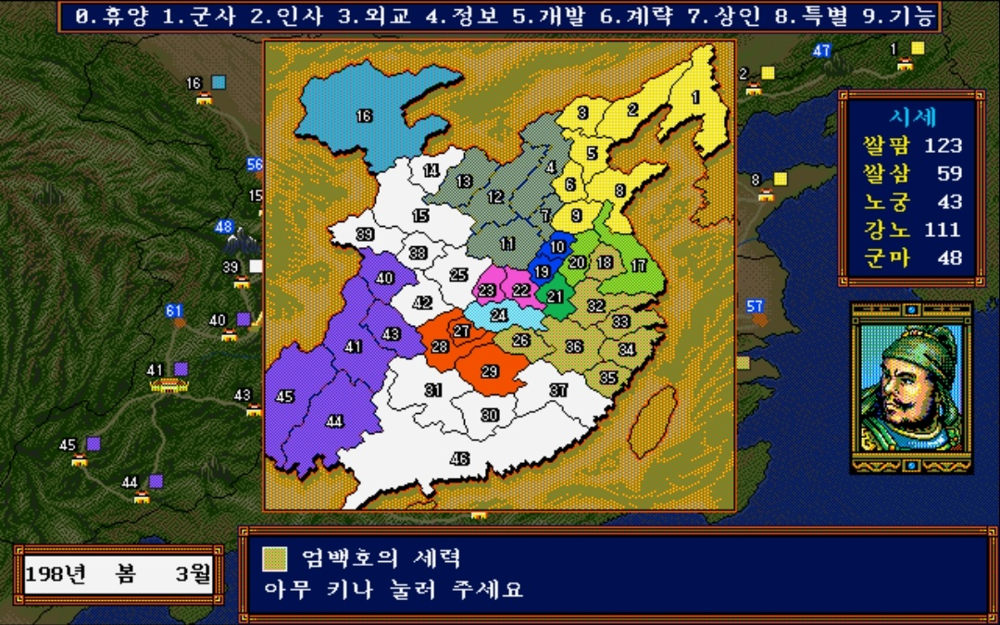 | 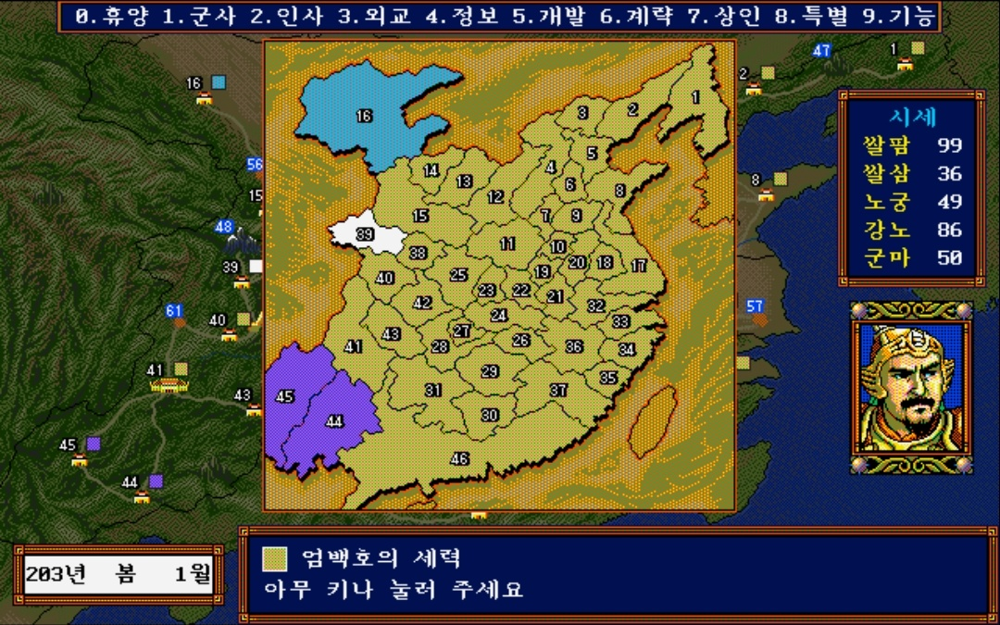 | 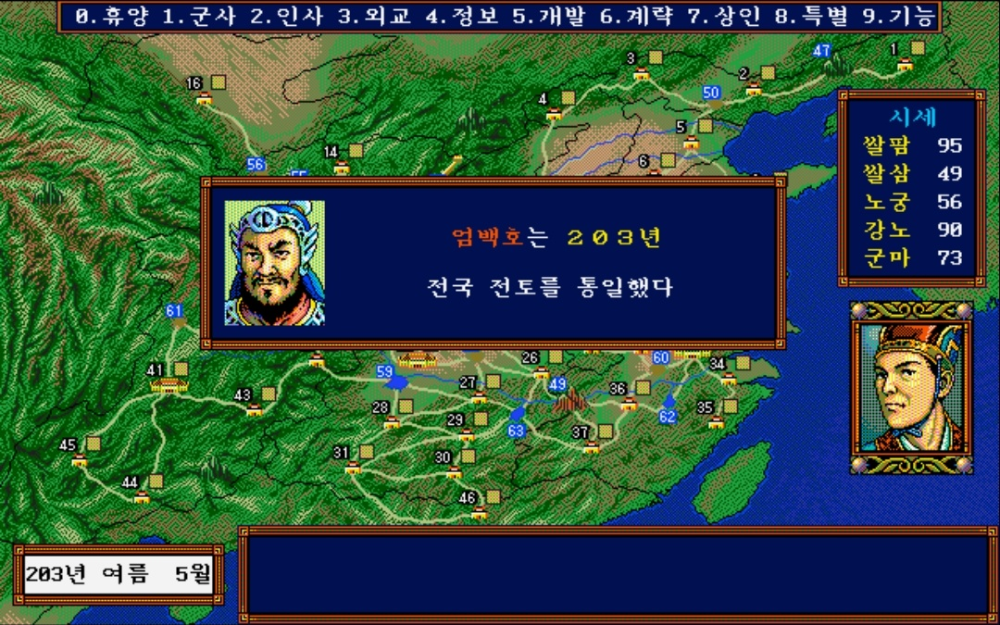 |

---

### 👑 공주 (진짜 극악 난이도)
- **왜 어려운가?**
  - **혈혈단신 1인 시작:** 장수가 공주 혼자뿐이라 병사 1명 훈련 꼼수도 못 쓰고 훈련 효율이 극악입니다.
  - **최악의 입지:** 주변이 **조조, 원술, 도겸, 동탁**으로 둘러싸여 있어 초반 버티기가 정말 어렵습니다. 땅 자체도 위험한 위치인 데다 생산 효율도 낮고 충성도 관리도 힘듭니다.
- **초반 돌파기 (첫 장수 1명 구하기가 최대 고비):**
  1. 문관이든 무관이든 **아무 장수나 1명 등용할 때까지가 가장 큰 고비**입니다. 한 명만 들어오면 그때부터 반은 성공입니다.
  2. 주변 세력들이 끊임없이 전쟁을 벌이므로 포로가 자주 발생합니다. 전쟁 중인 곳에 밀정을 보내 등용 노가다(세이브/로드)를 노려야 합니다.
  3. **실전 영입 과정:**
     - 처음에 재야/수색으로 **`두습`** 이 등장해 세이브/로드 끝에 겨우 첫 장수로 등용 완료!
     - 이어서 도겸 땅에 밀정을 보냈더니 조조의 핵심 모사인 **`순욱`** 이 포로/등용 상태로 있는 것을 발견! (전쟁으로 빼앗아 온 장수라 충성도가 낮을 것이라 판단)
     - 밀정 파견 후 등용 세이브/로드를 통해 **`순욱`** 영입에 성공하면서 단숨에 A급 군사를 확보했습니다. *(밀정 보내고 6개월 뒤 충성도를 확인한 다음 로드해서 진행해도 됩니다.)*
  4. **중반 이후 운영:** 두습과 순욱을 확보한 뒤에는 병력을 훈련시켜 방어 태세를 갖추고, 순욱 군사의 조언을 활용해 장수를 하나씩 늘려갔습니다. 이후 도겸/유언/유표 등과 동맹을 맺어 1월 금·7월 군량 원조로 버티면서, **군량 소모전**으로 영토를 야금야금 먹어가며 천하통일에 성공했습니다.

---

## 3. 공주 플레이 중 발생한 주요 이벤트 & 통일 스샷

공주는 처음 시작할 때 **매력이 40대**에 불과했지만, 아래 두 이벤트를 거치면서 **매력 100**을 달성했습니다.

### ① 조정 밀정 (헌제) 이벤트 — 197년 5월
- **발생 조건:** **11번 낙양**을 점령한 군주의 영토와 **인접**해 있으면 랜덤하게 발생합니다.
- **실전 상황:** 동탁이 11번 낙양을 먹고 허창까지 점령한 상태였는데, 내가 **초(譙) 땅**에 있어서 동탁 영토와 인접 판정을 받아 이벤트가 발생했습니다.
- **효과:** 매력 40대였던 공주의 매력이 단숨에 **80대**로 상승!

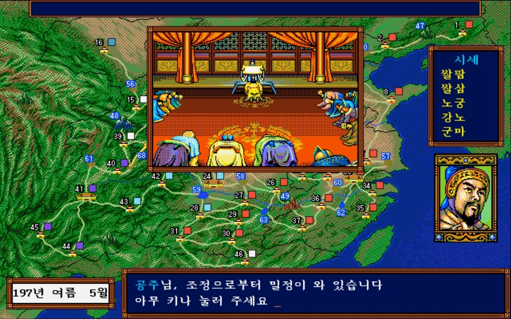

### ② 왕윤 & 초선 합류 이벤트 — 198년 1월
- **발생 조건:**
  1. 군주와 부하 무장 **왕윤**이 모두 **장안(13번)** 에 소재
  2. 왕윤의 충성도 **100**
  3. 장안의 민충성도 **100**
  4. 장안 내정 수치 **토지개발 / 치수 / 관개 모두 80 이상**
  5. 장안 **세율 39% 이하**
  6. 위 조건을 만족한 상태로 **1~3월**에 턴을 넘기면 발생
- **효과:** 초선이 부하 장수로 합류하며 군주 매력이 대폭 상승해 **공주 매력 100 달성!**

| 1. 왕윤 참내 (198년 1월) | 2. 왕윤의 제안 |
| :---: | :---: |
| 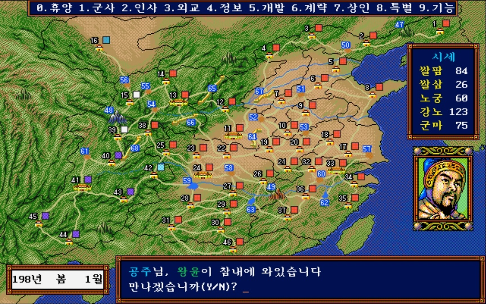 | 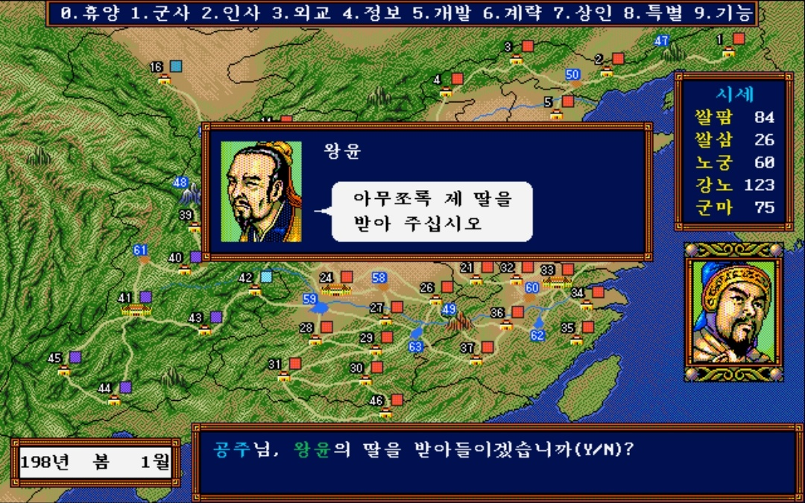 |
| **3. 초선 등장 컷신** | **4. 초선 임관 완료** |
| 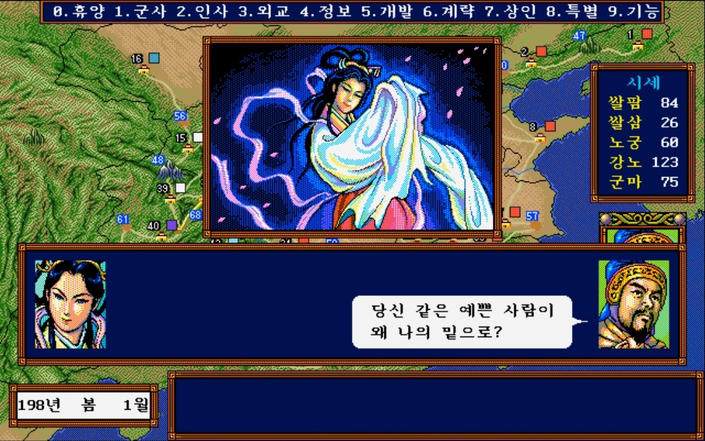 | 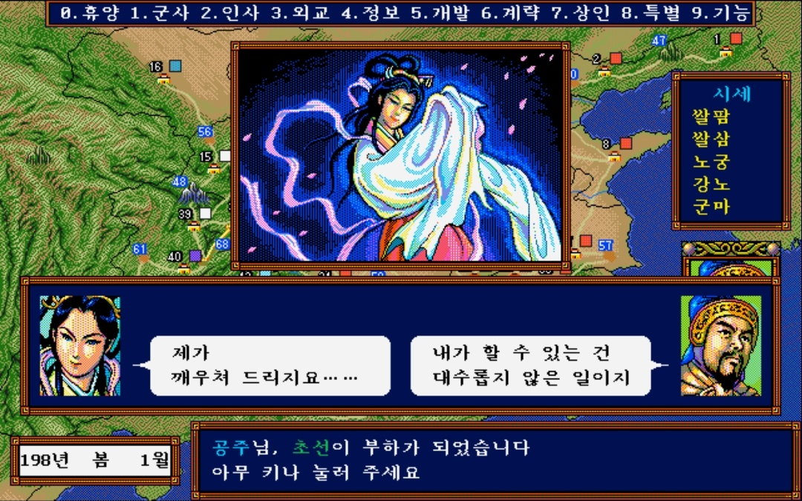 |

### ③ 외교 항복 권고 & 공주 천하통일 — 198년 9월
마지막 남은 44번 건녕의 군주 **유언**에게 사신 **순유**를 보내 외교 권고로 항복을 받아내며 198년 가을 9월 천하통일을 달성했습니다.

| 순유 사신 파견 → 유언 항복 | 공주 천하통일 (198년 9월) |
| :---: | :---: |
| 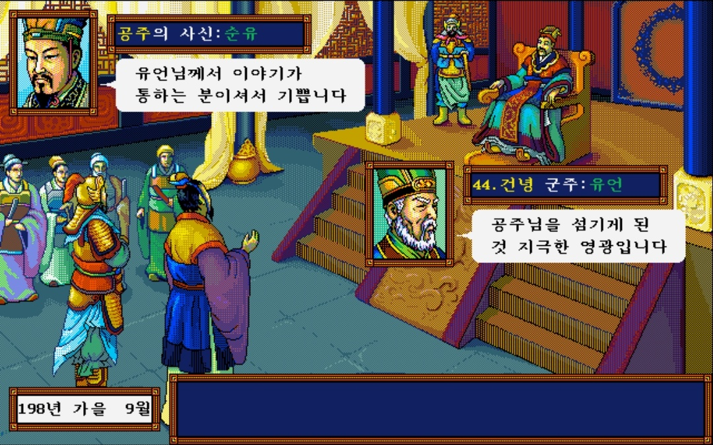 | 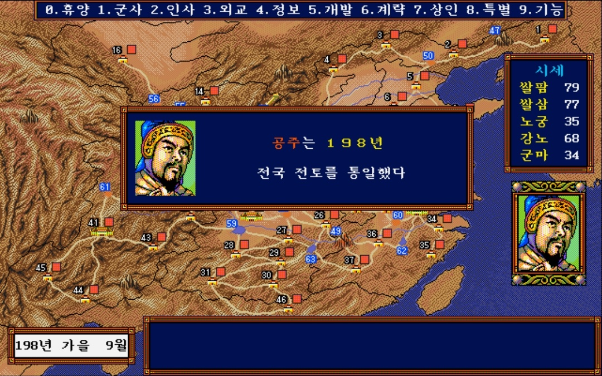 |

---

## 4. 기타 군주 천하통일 기록

### 🔹 유비 천하통일 (207년 2월)
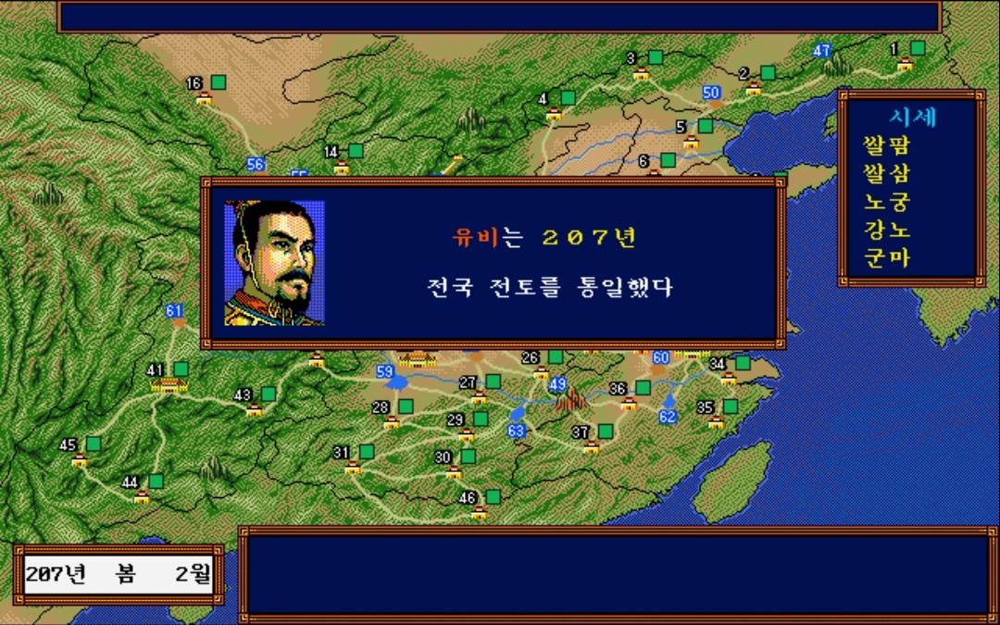

### 🔹 신군주 '일' 천하통일 (197년 8월 · 군사 괴량)
| 성도 내정 화면 | 천하통일 (197년 8월) |
| :---: | :---: |
| 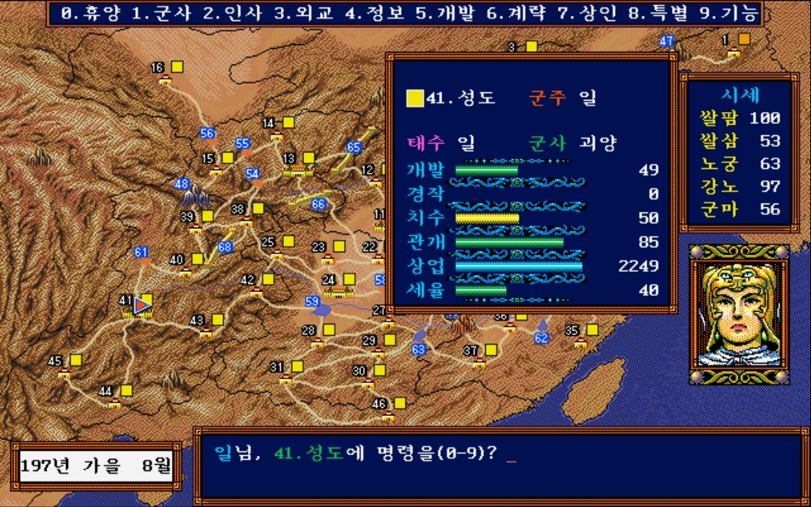 | 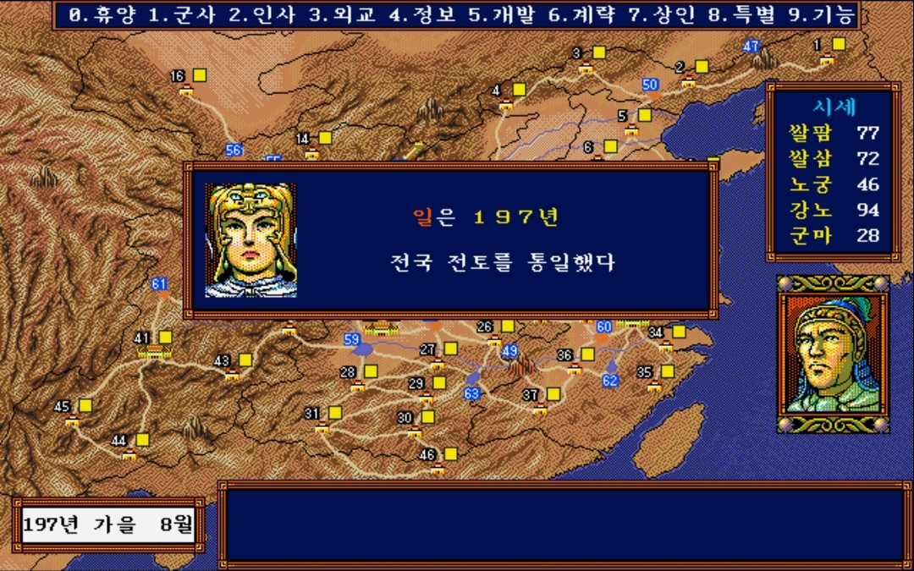 |

### 🔹 신군주 '하나' 천하통일 (202년 7월 · 태수 서황, 군사 방통)
| 북평 내정 화면 | 천하통일 (202년 7월) |
| :---: | :---: |
| 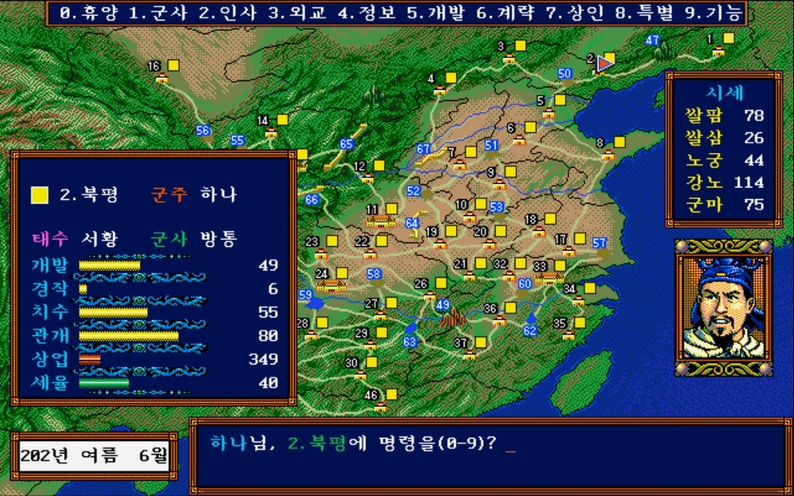 | 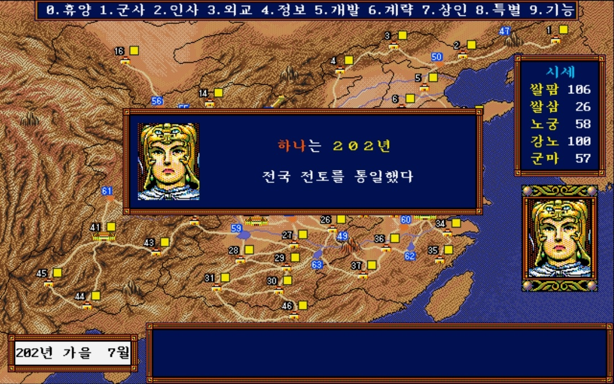 |

---

## 5. 마등 실전 플레이 기록 (215년 2월 천하통일)

### 🐎 초기 전력 분석 & 구상 (시나리오 4: 208년 '공명, 중원에서 활약')
- **초기 강점:** 시작 시 **군사가 아예 없다**는 치명적 약점이 있지만, 머릿수는 꽤 많고 무력이 출중한 핵심 4인방(**마등, 마초, 마대, 방덕**)이 건재합니다. 특히 시작부터 **군마가 100 이상** 확보되어 있는 점은 큰 장점입니다.
- **현실적인 한계:** 주력 4인방을 제외한 나머지 부하들은 지력이 처참하고 무력·매력도 어중간해 활용도가 매우 낮으며, 서량 일대 시작 땅도 부유하지 못합니다.
- **초반 전략 구상:** 병력을 모아 한중의 **장로**를 쳐서 군사감인 **`염포`** 를 확보한 뒤, **장안 → 낙양** 순으로 치고 나가는 시나리오를 계획했습니다.

### 🏯 한중 정착의 딜레마와 사방 포위망 돌파
1. **장로 멸망 & 한중 본진화:**
   - 계획대로 병력을 모아 장로를 멸망시키고 **`염포`** 를 얻은 뒤, 병력을 빼지 않고 내정이 어느 정도 갖춰진 **한중에 그대로 눌러앉기로 결정**했습니다.
   - **보급선 문제:** 한중이 기존 시작 영토와 바로 이어지지 않아 중간 거점에 장수를 배치해야 했고, 능력치 높은 내정 요원이 없다 보니 자원을 한중으로 효율적으로 끌어모으기 위해 아까운 **마대나 방덕을 후방 태수로 임명**해야 했습니다.
2. **삼면초가(북 조조 · 남 유비 · 서 유장)와 동맹 배신 역이용:**
   - 한중은 북쪽 **조조**, 남쪽 **유비**, 서쪽 **유장**과 모두 맞닿아 사방에서 공격이 쏟아졌습니다. 특히 **유비**가 끝없이 쳐들어와서 세이브/로드로 공격을 안 오게 해보려 했으나 도저히 불가능해, 일단 **유비·유장 양측과 동맹**을 맺어 급한 불을 껐습니다.
   - 그렇게 버티던 중 **유비가 동맹 상태에서 협공으로 배신**을 때렸고, 마침 유장 세력이 허약해진 틈이 보여 **유장을 먼저 역공**하기 시작했습니다. 그 와중에 북쪽 **장안**도 소모전 끝에 가까스로 빼앗았습니다.
3. **기병 돌격 생포(`하후연`·`이엄` 확보) & 낙양 점령:**
   - 조조와 유장이 **5,000명 미만의 소규모 병력**으로 공격해 올 때마다, 적 병력이 **2,000명 미만**으로 줄어든 순간 **마초·방덕의 돌격**으로 적장을 직접 사로잡아 **`하후연`** 과 **`이엄`** 을 등용하는 쾌거를 올렸습니다.
   - 또한 유비·유장이 동맹 상태에서 선제공격을 해왔기 때문에 **동맹 파기 페널티로 적 장수들의 충성도가 낮아진 상태**였고, 이를 놓치지 않고 유장 세력을 **등용 + 공격**으로 하나씩 잠식해 들어갔습니다.
   - 북쪽 조조 전선 역시 **군량 소모전**으로 밀어붙여 마침내 **낙양**까지 점령했습니다.
4. **천군만마 같았던 군사 `이적`(지력 84 → 94) 영입:**
   - 초반에는 군사 **`염포`** 로 버티며 진행하다가 중반에 **`이적`(지력 84)** 을 얻게 되었고, 곧바로 **손자병법(+10)** 을 수여해 **지력 94 군사**로 만들어 아주 요긴하게 활용했습니다. 마등 세력 특성상 지력 90 넘는 장수가 너무나 아쉬웠던 터라, `이적` 한 명 들어왔을 때 정말 천군만마를 얻은 듯한 기분이었습니다.

### ⚔️ 허창 25만 대군 방어전 & 조조 영토 분단 각개격파
- **괴물 같은 조조 본진의 물량:** 낙양을 점령하고 정찰해 보니 조조의 병력이 상상을 초월했습니다. 특히 **허창(군사 사마의)은 병력 약 25만(248,900명)에 군량 40만(409,251)** 이 쌓여 있었고, 낙양을 지키고 있으면 **허창에서 7만 대군 + 완에서 추가 병력**이 연달아 몰려오는 파상공세가 이어졌으나 간신히 방어해 냈습니다.
- **영토 허리 끊기(분단) 후 각개격파:** 끈질기게 낙양을 수성하며 병력을 모으고 남쪽 유비 세력을 조금씩 정리하다 보니 마침내 반격 기회가 찾아왔습니다. 아래 스크린샷처럼 조조 영토의 허리를 파고들어 **서로 고립(분리)시켜 놓은 뒤, 떨어져 있는 거점들을 하나씩 각개격파**하며 땅을 야금야금 먹어 치웠습니다.

### 🏆 조식 항복 해프닝('태수 겸 군사' 진풍경) & 총평
- **조식 외교 항복 해프닝:** 각개격파 끝에 **조조**를 잡아 처단하고 뒤를 이은 **조식**에게 항복을 받아냈는데, `5. 남피` 도시 정보를 보니 원래는 동시에 맡을 수 없는 **`태수: 조식 / 군사: 조식`** 으로 한 인물이 태수와 군사에 중복 등록되어 있는 신기한 현상이 발생해 기념으로 스크린샷을 남겨두었습니다.
- **천하통일 마무리:** 그렇게 조조 세력을 완전히 정리한 뒤, 마지막 남은 **오나라(군주 손권)** 세력까지 모두 밀어내고 **215년 봄 2월 천하통일**을 달성했습니다.
- **실전 총평:** 마등이라서 무난하고 쉬울 줄 알았는데, 4번 시나리오 특성상 **조조의 압도적인 병력은 물론 유비·손권 쪽 물량까지 엄청나서 결코 쉽지 않은 판**이었습니다. 특히 한중 정착 직후 사방에서 공격이 쏟아지는 **초반부에는 세이브/로드를 정말 많이 해야 버틸 수 있었습니다.**

| 1. 시나리오 4 시작 화면 (208년 1월 · 서량, 군사 없음) | 2. 괴물 같은 허창 물량 (212년 2월 · 병사 25만 / 군량 41만) |
| :---: | :---: |
| 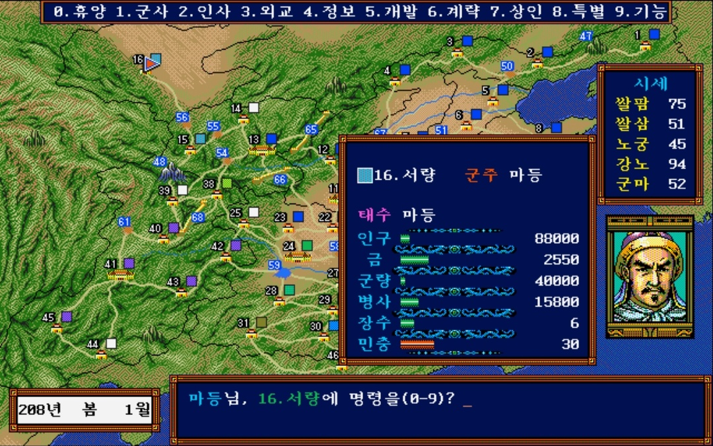 | 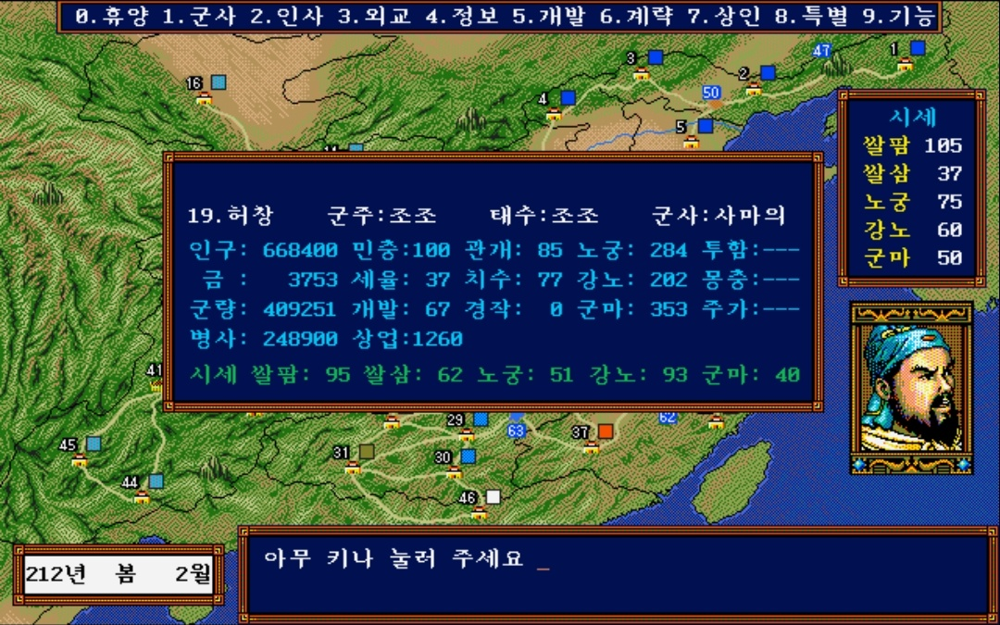 |
| **3. 조조 영토 분단 각개격파 판세 (214년 8월 · 강하, 군사 제갈량)** | **4. 조식 항복 직후 '태수·군사 동시 조식' 진풍경 (215년 2월 · 남피)** |
| 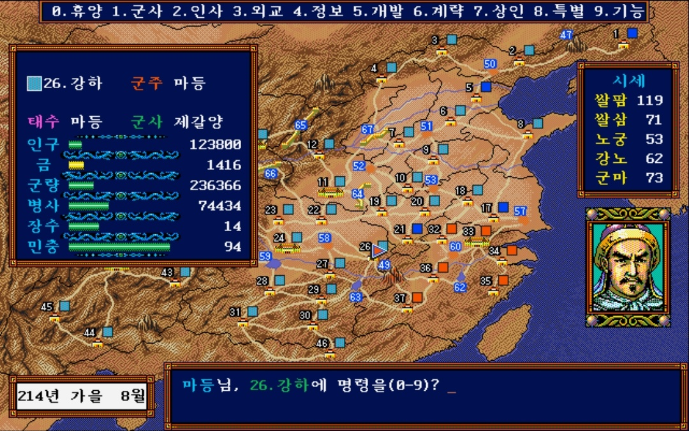 | 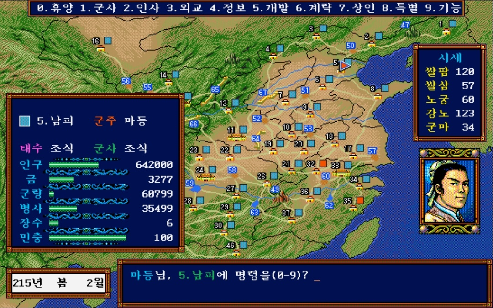 |
| **5. 적 전멸 후 마지막 공백지 직전 (215년 2월 · 오, 태수 손항)** | **6. 마등 천하통일 달성 (215년 2월)** |
| 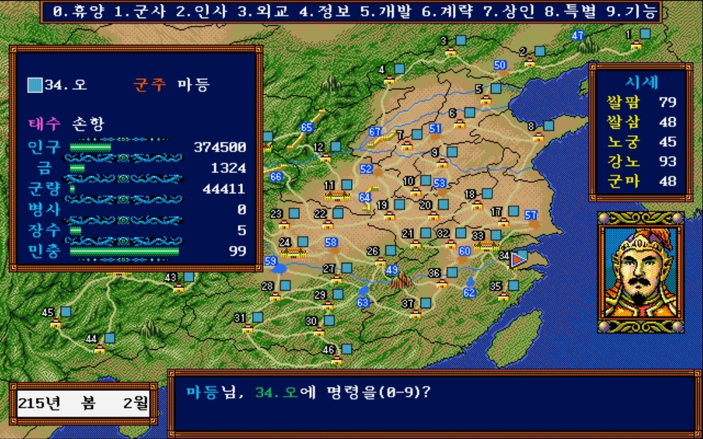 | 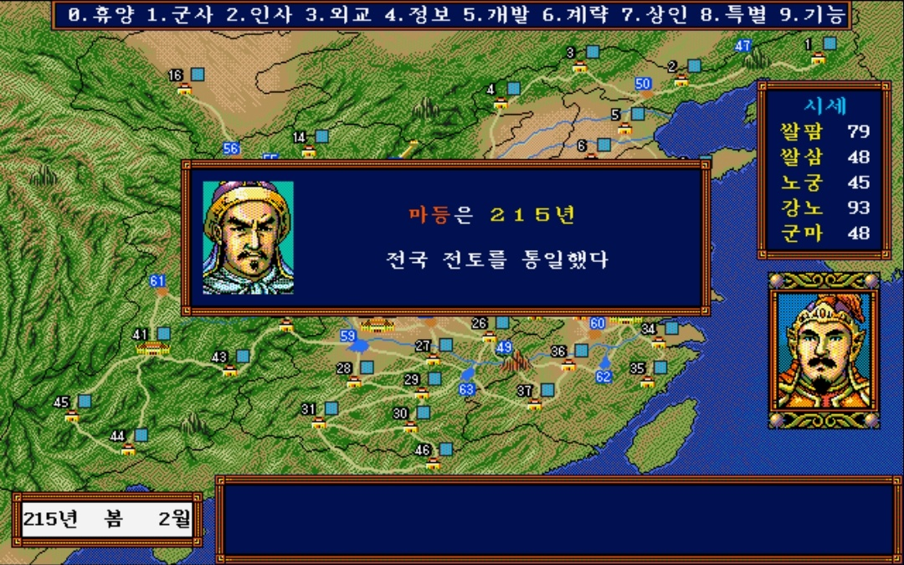 |
