# 삼국지 3 플레이 메모 & 공략 정리

직접 플레이하면서 정리한 **삼국지 3 핵심 공략 팁(인사·내정·외교·전투 꼼수)** 과 **군주별 실전 플레이 기록(공주·엄백호 등)** 입니다.

---

## 1. 핵심 공략 & 꼼수 정리

### ① 군사(지력 100) 확보와 등용 노가다
- **지력 100 군사는 거짓말을 하지 않는다:** 지력 100인 군사를 두면 등용 시도 시 조언이 100% 정확합니다. 등용을 반복(세이브/로드 등)하다가 군사가 성공 메시지를 띄울 때 진행하면 무조건 성공합니다.
- **손자병법(+10) 활용:** 기본 지력 100인 장수는 구하기 어렵기 때문에, **지력 90 이상 장수**를 먼저 확보한 뒤 **손자병법(지력 +10)** 을 수여해 지력 100을 맞추면 됩니다.
  - **초반 시나리오 추천 군사:** `이유`, `순욱`, `전풍`, `순유`, `가후`
  - **중·후반 무난한 군사:** `방통`, `주유`
  - 꼭 100을 딱 못 채우더라도 **지력 98~99** 정도만 되어도 아쉬운 대로 충분히 활용 가능합니다.
- **포로 장수 가로채기:** 다른 나라끼리 전쟁하는 것을 지켜보다가 장수가 포로로 잡혔다면, 곧바로 그 도시에 **밀정**을 보내두고 등용 노가다를 합니다. 군사가 긍정 조언을 할 때 등용을 찔러 넣으면 알짜 장수를 빼올 수 있습니다.
- **계략 '위서의심'과 등용 가능 충성도 커트라인:**
  - **위서의심 활용법:** 상대 장수의 충성도를 낮추는 `위서의심`은 성공 확률이 매우 낮고 아예 통하지 않는 장수도 있습니다. 따라서 **지력 100인 군사**를 둔 상태에서 꼭 빼와야 할 핵심 장수(예: 적 도시 태수 등)가 있다면, 위서의심을 여러 번 반복 시도하다가 **군사가 성공한다고 하는 순간 딱 한 번 보내 충성도를 깎은 뒤 곧바로 등용**을 시도해야 합니다.
  - **목표 충성도 기준:** 원래 충성도가 100인 장수는 위서의심이 먹혀봤자 90점대 중후반이라 큰 의미가 없고, **충성도가 95 정도인 장수**에게 쓰면 해볼 만합니다.
  - **등용 가능 충성도:** 삼국지 3에서는 장수 충성도가 **91**이어도 등용을 반복 시도하다 보면 성공하는 순간이 오며, 실제로 **충성도 93까지도 등용에 성공**해 봤습니다.

### ② 병사 1명 훈련 후 재편성 팁
- 훈련을 시킬 때 **훈련시킬 장수에게 병사 1명만 배치**한 상태로 훈련을 시작합니다.
- 그다음 **병력 재편성**으로 원래 채울 병력을 넣어줍니다.
- 게임 시스템상 '병사 1명을 훈련한다'고 판정해 훈련 상승폭이 크게 적용되는데, 결과적으로는 **재편성으로 늘어난 전체 병력의 훈련도가 한꺼번에 오르는 효과**를 볼 수 있습니다.
  - ⚠️ 단, 장수가 군주 혼자뿐이면 재편성해 줄 다른 장수가 없어 이 팁을 쓸 수 없으므로 **최소 장수 2명 이상**일 때 가능합니다.

### ③ 동맹 원조로 자금·군량 수급하기
- 만만한 군주(주로 **도겸, 유언, 유표** 등)와 동맹을 맺고 **원조**를 요청합니다.
- **시기별 받는 자원:**
  - **1월:** 금(군자금)
  - **7월:** 군량
- 처음부터 큰 금액을 요구하면 거절당하므로 **100 → 1,000 식으로 조금씩 금액을 늘려가며** 요청하는 것이 핵심입니다.

### ④ 99명 기병을 이용한 '상대 군량 태우기' (소모전)
대규모 병력이 버티고 있는 적 도시도 **군량 소모전**을 활용하면 손쉽게 점령할 수 있습니다. (전투에서 상대 군량이 `0`이 되면 즉시 승리)

| 항목 | 세부 수치 및 메커니즘 |
| :--- | :--- |
| **출진 병력** | **병사 99명** (99명이어야 군마 편성 가능) |
| **휴대 군량** | **약 120** (공성전 기준 30턴 완주 가능) |
| **30턴 계산법** | 한 달 전투는 총 **10일 × 하루 3끼(아침·점심·저녁) = 30턴** |
| **아군 소모량** | 99명 기준 **1턴당 군량 4 소모** → `4 × 30턴 = 120` |
| **적군 소모량** | 전투에 나온 병력만이 아니라 **도시의 총 병사 수 비례**로 매 턴 군량 대량 소모 |

1. **반복 투입:** 한 달 안에 99명 기병 부대를 여러 번 투입해 30턴 직전까지 버티다 퇴각하면, 적 도시는 총 병력수만큼 군량이 뭉텅이로 깎여 결국 10일을 못 버티는 시점이 옵니다.
   - ⚠️ 30턴이 다 되기 전에 퇴각해야 하며, 퇴각 시 장수가 잡힐 수 있으니 **세이브는 필수**입니다.
2. **적 군량 바닥 직전 '돌격 방지' 고급 팁:**
   - 적 군량이 거의 바닥나면 AI가 가만히 있지 않고 성 밖으로 달려나옵니다.
   - 이때는 **내 군량을 상대가 버틸 수 있는 턴보다 1턴치 적게** 들고 갑니다. (예: 상대 군량이 20턴 버틸 양이면, 내 군량은 **19턴 버틸 양**만 지참)
   - 그러면 AI는 **공격측(나)이 먼저 군량 부족으로 퇴각할 것이라 판단해 성 밖으로 달려나오지 않습니다.** 덕분에 안전하게 적 군량을 끝까지 태우고 퇴각할 수 있습니다.

### ⑤ 동맹 파기 유도 후 적 태수 통째로 등용하기 (무혈 점령)
- 상대와 동맹을 맺은 상태에서 적대치가 낮을 때(80 미만 등) 동맹을 파기하면, **파기한 쪽 군주의 부하 충성도와 능력치에 큰 페널티**가 들어갑니다.
- **유도 방법:**
  1. 상대국과 동맹을 맺습니다.
  2. 적과 인접한 내 도시에 **병력을 0으로 비우거나**, **병사 수 ≫ 군량** 같은 허술한 세팅으로 미끼를 던져둡니다.
  3. AI는 욕심에 눈이 멀어 **동맹 상태인데도 선제공격**을 해오며 스스로 **동맹 파기 페널티**를 뒤집어씁니다.
  4. 적 장수들의 충성도가 일제히 깎인 틈을 타 **적 도시의 태수를 등용**해 버리면 싸우지 않고 도시를 통째로 흡수할 수 있습니다.

---

## 2. 엄백호 vs 공주 실전 난이도 비교

처음에는 **엄백호**가 최약체라 가장 어려울 줄 알았지만, 직접 해보니 **진짜 하드 모드는 공주(孔伷)** 였습니다.

### 🐯 엄백호 (생각보다 무난함)
- **초반 기반:** 엄백호·엄여 **2명**으로 시작하기 때문에, 시작하자마자 **병사 1명 훈련 + 재편성 꼼수**로 훈련도 100을 채우고 사기를 올릴 수 있습니다.
- **확장 루트:**
  1. 훈련을 마친 뒤 바로 아래 **왕랑** 땅을 공격해 왕랑 휘하 장수들을 흡수합니다.
  2. 전력을 정비하며 간을 보다가 **유요**를 공격해 강동을 장악합니다. (유요 휘하의 **태사자**만 주의해서 공략하면 이후부터는 무난하게 천하통일 가능!)

| 엄백호 세력 확장 (198년 3월) | 엄백호 천하통일 (203년 5월) |
| :---: | :---: |
| 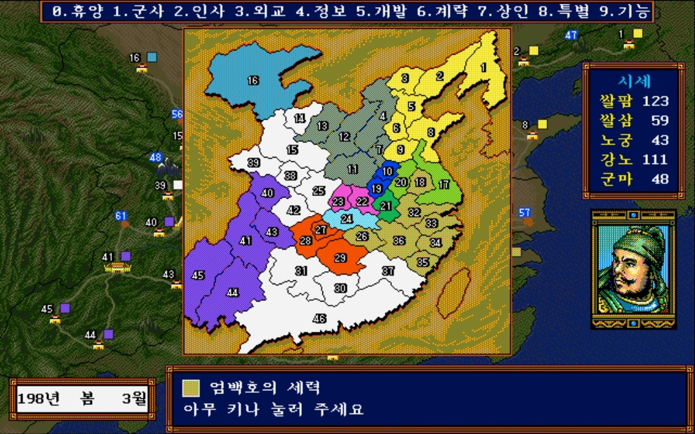 | 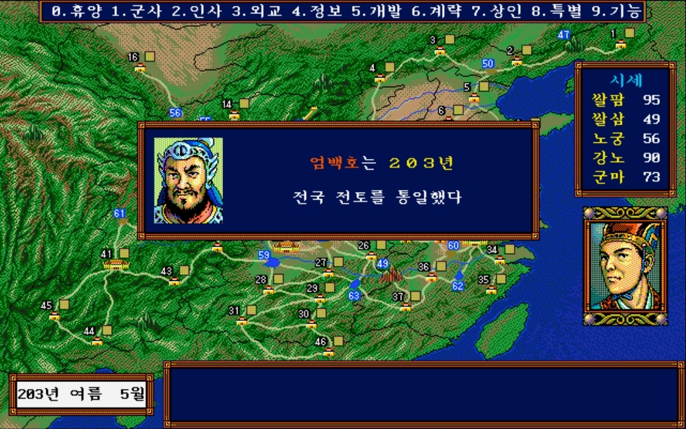 |

---

### 👑 공주 (진짜 극악 난이도)
- **왜 어려운가?**
  - **혈혈단신 1인 시작:** 장수가 공주 혼자뿐이라 병사 1명 훈련 꼼수도 못 쓰고 훈련 효율이 극악입니다.
  - **최악의 입지:** 주변이 **조조, 원술, 도겸, 동탁**으로 둘러싸여 있어 초반 버티기가 정말 어렵습니다. 땅 자체도 위험한 위치인 데다 생산 효율도 낮고 충성도 관리도 힘듭니다.
- **초반 돌파기 (첫 장수 1명 구하기가 최대 고비):**
  1. 문관이든 무관이든 **아무 장수나 1명 등용할 때까지가 가장 큰 고비**입니다. 한 명만 들어오면 그때부터 반은 성공입니다.
  2. 주변 세력들이 끊임없이 전쟁을 벌이므로 포로가 자주 발생합니다. 전쟁 중인 곳에 밀정을 보내 등용 노가다(세이브/로드)를 노려야 합니다.
  3. **실전 영입 과정:**
     - 처음에 재야/수색으로 **`두습`** 이 등장해 세이브/로드 끝에 겨우 첫 장수로 등용 완료!
     - 이어서 도겸 땅에 밀정을 보냈더니 조조의 핵심 모사인 **`순욱`** 이 포로/등용 상태로 있는 것을 발견! (전쟁으로 빼앗아 온 장수라 충성도가 낮을 것이라 판단)
     - 밀정 파견 후 등용 세이브/로드를 통해 **`순욱`** 영입에 성공하면서 단숨에 A급 군사를 확보했습니다. *(밀정 보내고 6개월 뒤 충성도를 확인한 다음 로드해서 진행해도 됩니다.)*
  4. **중반 이후 운영:** 두습과 순욱을 확보한 뒤에는 병력을 훈련시켜 방어 태세를 갖추고, 순욱 군사의 조언을 활용해 장수를 하나씩 늘려갔습니다. 이후 도겸/유언/유표 등과 동맹을 맺어 1월 금·7월 군량 원조로 버티면서, **군량 소모전**으로 영토를 야금야금 먹어가며 천하통일에 성공했습니다.

---

## 3. 공주 플레이 중 발생한 주요 이벤트 & 통일 스샷

공주는 처음 시작할 때 **매력이 40대**에 불과했지만, 아래 두 이벤트를 거치면서 **매력 100**을 달성했습니다.

### ① 조정 밀정 (헌제) 이벤트 — 197년 5월
- **발생 조건:** **11번 낙양**을 점령한 군주의 영토와 **인접**해 있으면 랜덤하게 발생합니다.
- **실전 상황:** 동탁이 11번 낙양을 먹고 허창까지 점령한 상태였는데, 내가 **초(譙) 땅**에 있어서 동탁 영토와 인접 판정을 받아 이벤트가 발생했습니다.
- **효과:** 매력 40대였던 공주의 매력이 단숨에 **80대**로 상승!

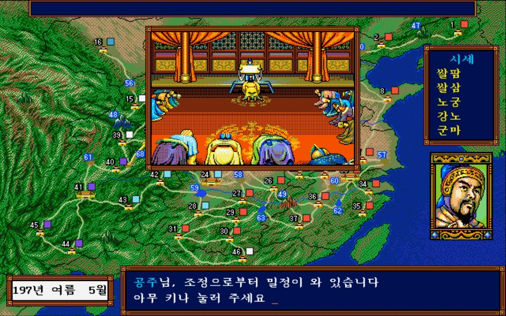

### ② 왕윤 & 초선 합류 이벤트 — 198년 1월
- **발생 조건:**
  1. 군주와 부하 무장 **왕윤**이 모두 **장안(13번)** 에 소재
  2. 왕윤의 충성도 **100**
  3. 장안의 민충성도 **100**
  4. 장안 내정 수치 **토지개발 / 치수 / 관개 모두 80 이상**
  5. 장안 **세율 39% 이하**
  6. 위 조건을 만족한 상태로 **1~3월**에 턴을 넘기면 발생
- **효과:** 초선이 부하 장수로 합류하며 군주 매력이 대폭 상승해 **공주 매력 100 달성!**

| 1. 왕윤 참내 (198년 1월) | 2. 왕윤의 제안 |
| :---: | :---: |
| 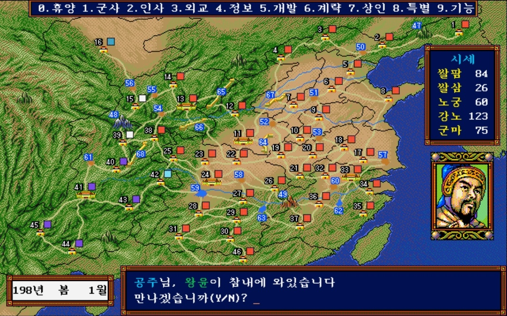 | 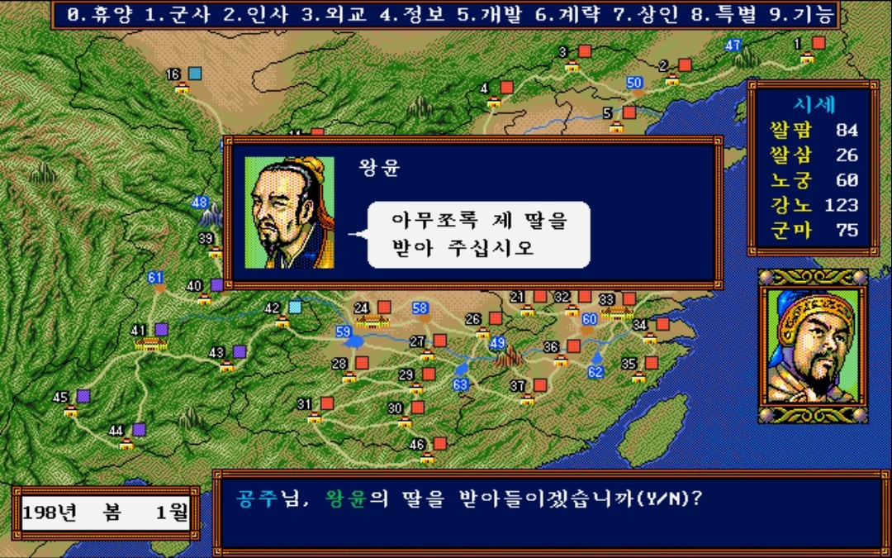 |
| **3. 초선 등장 컷신** | **4. 초선 임관 완료** |
| 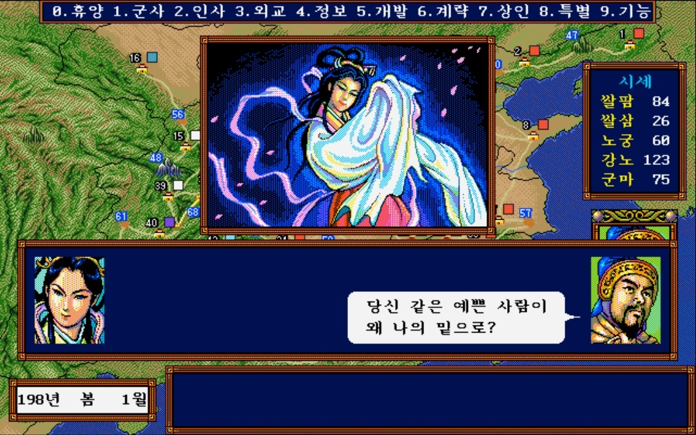 | 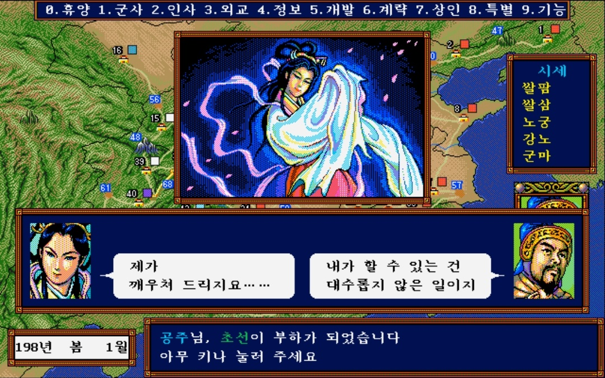 |

### ③ 외교 항복 권고 & 공주 천하통일 — 198년 9월
마지막 남은 44번 건녕의 군주 **유언**에게 사신 **순유**를 보내 외교 권고로 항복을 받아내며 198년 가을 9월 천하통일을 달성했습니다.

| 순유 사신 파견 → 유언 항복 | 공주 천하통일 (198년 9월) |
| :---: | :---: |
| 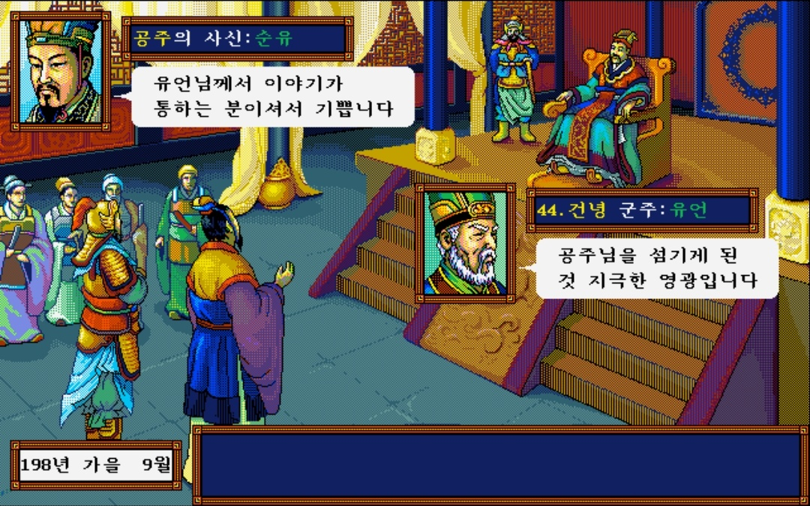 | 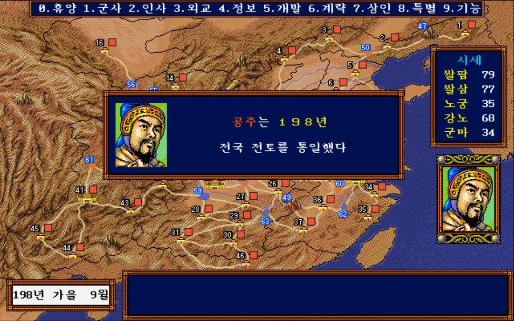 |

---

## 4. 기타 군주 천하통일 기록

### 🔹 유비 천하통일 (207년 2월)
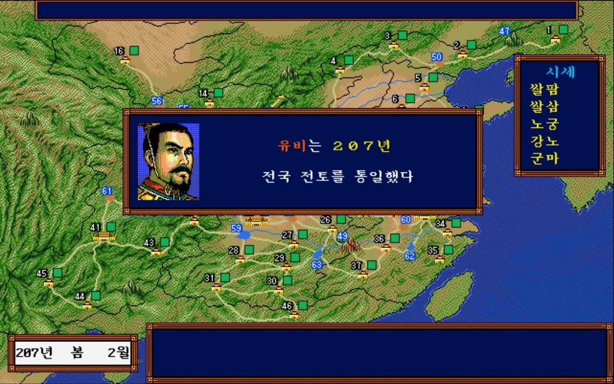

### 🔹 신군주 '일' 천하통일 (197년 8월 · 군사 괴량)
| 성도 내정 화면 | 천하통일 (197년 8월) |
| :---: | :---: |
| 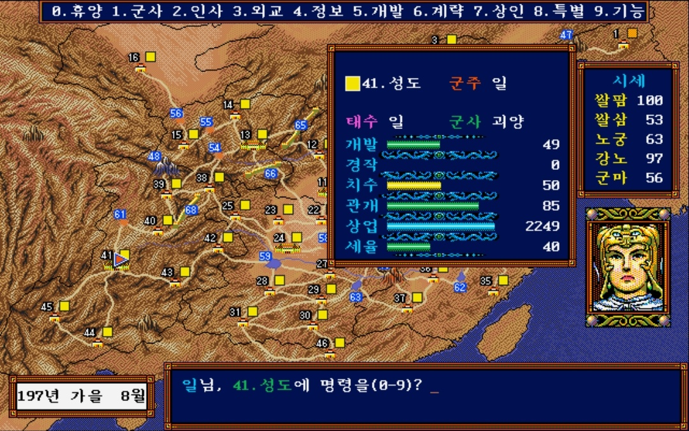 | 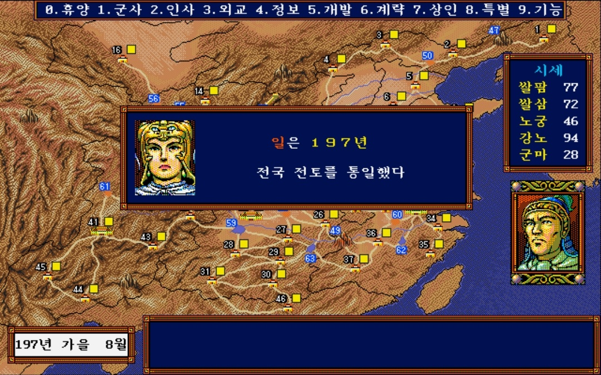 |

### 🔹 신군주 '하나' 천하통일 (202년 7월 · 태수 서황, 군사 방통)
| 북평 내정 화면 | 천하통일 (202년 7월) |
| :---: | :---: |
| 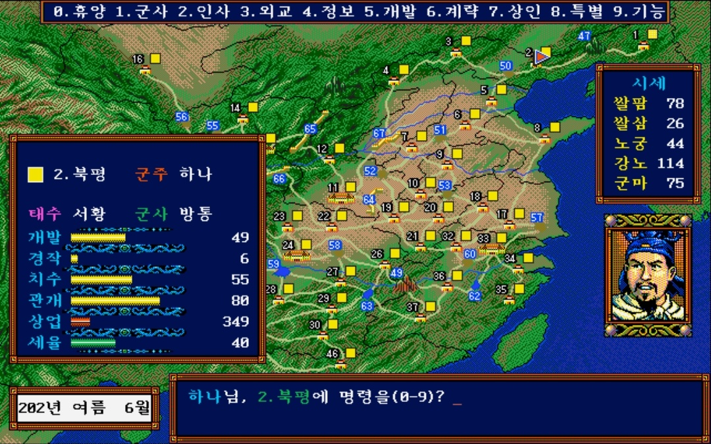 | 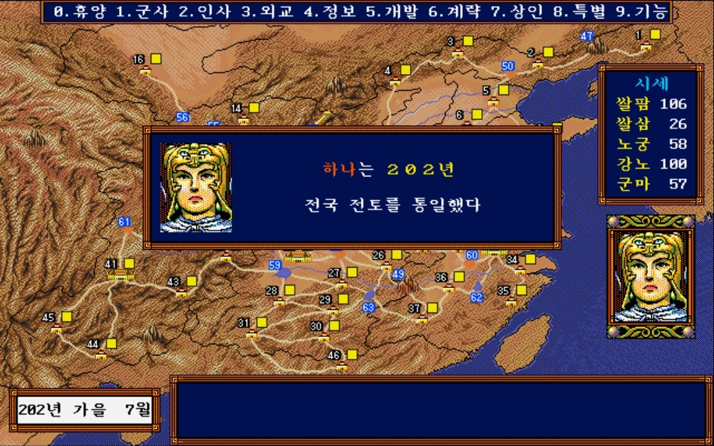 |
