# 진격의 거인 정리

2026-09-10 대화 기록에서 정리. 중간부터 흐름 놓친 부분 위주 Q&A.

## 전체 연표

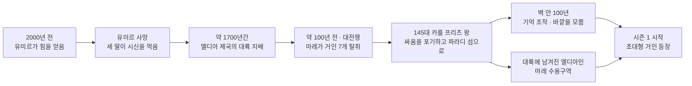

**왕이 일부만 데려갔다**는 게 이 그림의 핵심입니다. 여기서 갈라진 두 갈래가 시즌 4에서 다시 만납니다.


---

## Q. 진격의 거인 아무리 봐도 중간부터 흐름을 놓치거든, 짦게 요약을 해볼래? 이해하기 쉽게. 그거 참고해서 다시 보려고

시즌 4부터 갑자기 배경이 바뀌어서 놓치기 쉽습니다. **세계관이 세 번 뒤집힌다**는 구조로 잡으면 따라가기 쉬워요.

### 큰 흐름 3단계

**1단계 — 벽 안이 전부인 줄 알았던 시기 (시즌 1~3 전반)**
거인은 정체불명의 괴물, 인류는 벽 안이 전부. 목표는 "거인을 없애고 바깥으로 나가는 것".

**2단계 — 지하실의 진실 (시즌 3 후반)** ← 여기가 분기점
바깥에는 멀쩡한 문명 세계가 있었고, **벽 안 사람들이 세계에서 미움받는 민족(엘디아인)** 이었습니다. 거인은 괴물이 아니라 **사람이 변한 것**이고요. 적은 거인이 아니라 **세계 전체**였다는 반전입니다.

**3단계 — 에렌의 선택 (시즌 4)**
무대가 적국 **마레**로 옮겨가고 새 인물이 쏟아집니다. 에렌은 벽 밖 인류를 절멸시키는 **땅울림**을 시작합니다.

### 알아두면 안 헷갈리는 개념 5개

| 개념 | 뜻 |
|---|---|
| **유미르의 백성** | 거인으로 변할 수 있는 혈통. 엘디아인 = 이 사람들 |
| **9개의 지성 거인** | 2000년 전 시조 유미르의 힘이 9개로 갈라진 것. 진격·시조·초대형·여성형·짐승 등 |
| **시조의 거인** | 그중 최강. 모든 유미르의 백성을 조종·기억조작 가능. 단 **왕가의 피**가 있어야 힘이 발동 |
| **13년의 저주** | 거인 힘을 이어받으면 13년 안에 죽음. 에렌에게 시간이 없던 이유 |
| **진격의 거인** | 에렌의 힘. **미래의 기억을 볼 수 있음** ← 3단계 이해의 열쇠 |

### 가장 헷갈리는 부분

**시간이 뒤엉킨 인과 구조**입니다. 에렌은 미래를 본 뒤, **과거의 아버지 그리샤를 조종해** 왕가 학살을 실행시킵니다. 어머니가 거인에게 잡아먹힌 것도 에렌이 개입한 결과예요.

즉 **"미래를 봤기 때문에 그 미래를 만들었다"** 는 닫힌 루프입니다. 원인과 결과가 순환하는 구조라 한 번에 이해 안 되는 게 정상입니다.

### 다시 볼 때

**시즌 3 파트2의 지하실 편부터** 보시면 됩니다. 거기서 세계관이 통째로 바뀌고, 시즌 4는 그 전제 위에서 시작하거든요. 시즌 4 초반에 낯선 인물들이 나오는 건 **적국 마레 쪽 시점**이라서고, 조금 지나면 기존 인물들과 합류합니다.

궁금하신 지점을 짚어주시면 그 부분만 더 풀어드릴게요.


---

## Q. 에렌은 왜 벽 밖 인류를 절멸시켰지?

세 겹으로 되어 있고, 에렌 본인도 마지막에야 인정합니다.

**1. 명분 — 생존**
세계 전체가 파라디 섬의 절멸을 원했습니다. 마레는 이미 도살 계획을 세웠고, 군사력 차이는 압도적이었어요. 방어로는 못 버티니 **먼저 없애는 것 말고 방법이 없다**는 게 표면적 논리입니다.

**2. 진짜 이유 — 자유에 대한 집착**
에렌은 어릴 때부터 벽 밖의 **광활한 자유**를 꿈꿨습니다. 그런데 막상 나가보니 바다 건너에 **사람이 살고 있었죠.** 그가 원한 건 아무도 없는 자유였고, 그래서 "저것들을 다 없애면 우리는 자유로워질까?"라고 묻습니다.

마지막에 아르민에게 털어놓는 게 이겁니다.
> "이유는 없어. 그냥 그러고 싶었어. 짓밟고 싶었어. **그렇게 태어난 거야.**"

명분이 아니라 **본성**이었다는 걸 스스로 인정하는 장면입니다.

**3. 계산 — 친구들을 영웅으로**
세계 80%를 파괴하고 **멈춥니다**. 친구들이 자신을 죽이게 만들어, 그들이 **세계를 구한 영웅**이 되게 하려는 설계였어요. 자기가 악역을 맡은 거죠.

**왜 다른 방법을 안 택했나** — 지크가 제안한 **안락사 계획**(엘디아인이 아이를 못 낳게 해서 자연 소멸)을 에렌은 거부합니다. 그건 자유가 아니니까요.

**가장 아이러니한 지점**은 마지막입니다. 자유를 위해 모든 걸 태웠는데, 정작 **자신은 미래에 본 그 길을 그대로 걸을 수밖에 없었습니다.** 자유를 좇은 인물이 인과율의 노예였다는 게 이 작품의 결론이에요.


---

## Q. 엘디아인을 왜 없애야했지?

두 가지가 겹쳐 있습니다 — **과거의 원한**과 **현재의 위협**입니다.

**1. 과거 — 800년의 지배와 학살**
엘디아 제국은 거인의 힘으로 세계를 정복하고, 마레를 비롯한 여러 민족을 짓밟았습니다. 학살과 강제 혼혈로 다른 문화를 지워버렸어요. 세계 입장에서 엘디아인은 **"악마의 후예"** 입니다. 벽 안 사람들만 이 역사를 모르고 있었던 거고요.

**2. 현재 — 존재 자체가 무기**
엘디아인은 **척수액 주사 한 방이면 누구든 거인이 됩니다.** 민간인 한 명이 도시 하나를 부술 수 있는 셈이에요. 아무 짓 안 하고 살아 있어도 **잠재적 대량살상무기**인 겁니다. 이게 "그럼 얌전히 살면 되지 않나"가 통하지 않는 이유입니다.

**3. 그런데 마레는 없애지 않고 이용했습니다**
수용구역에 격리하고 완장을 채워 감시하면서, 우수한 아이들을 뽑아 **전사(9개 거인 계승자)** 로 씁니다. 라이너·애니·베르톨트가 그렇게 온 애들이에요. 마레의 군사력 자체가 거인의 힘이라 없앨 수가 없었던 거죠.

**4. 그래서 표적은 파라디 섬**
세계가 진짜 두려워한 건 **시조의 거인**입니다. 모든 유미르의 백성을 조종할 수 있고, 벽 안에는 **수백만 마리분의 초대형 거인**이 잠들어 있었으니까요. 실제로 그게 땅울림으로 현실이 됐고요.

정리하면 **"과거에 우리를 짓밟았고, 지금도 우리를 멸망시킬 수 있다"** 는 게 세계의 논리입니다. 그리고 에렌이 땅울림을 실행하면서 **그 두려움이 옳았다는 게 증명돼버립니다.** 이 작품이 계속 던지는 질문이 여기 있어요 — 혐오가 먼저였나, 위협이 먼저였나.


---

## Q. 우수한 아이들은 엘디아인야 마레인이야?

**엘디아인**입니다. 마레인은 거인이 될 수 없어요.

거인화는 **유미르의 백성(엘디아인) 혈통에만** 나타나는 능력입니다. 마레인이 척수액을 맞아도 아무 일도 일어나지 않아요. 그래서 마레는 자기가 멸시하는 민족에게 최강 무기를 맡길 수밖에 없는 **모순된 구조**에 놓여 있습니다.

그 결과가 **명예 마레인** 제도입니다. 수용구역 아이들 중에서 전사 후보를 뽑고, 선발되면 가족까지 대우가 올라가요. 라이너가 그렇게 필사적이었던 이유고, 갈리아드 형제나 피크도 같은 처지입니다.

라이너·애니·베르톨트가 벽 안 사람들을 "악마"라 부르며 쳐들어온 게 이래서 비극적인 겁니다. **자기들도 똑같은 엘디아인**인데, 파라디 섬 사람들만 악마라고 교육받고 자랐거든요.


---

## Q. 그런데 마레인 중에서 주사를 놓아서 방치하는 장면이 나오자나

그 장면들의 **대상도 엘디아인**입니다. 주사를 놓는 쪽이 마레 군인이라 헷갈리기 쉬워요.

해당하는 장면이 둘 있습니다.

**1. "낙원 보내기"**
규칙을 어긴 엘디아인에게 "파라디 섬 낙원으로 보내주겠다"고 하고, 실제로는 절벽에서 주사를 놓아 **무지성 거인으로 만들어 방치**합니다. 그리샤의 첫 아내 **다이나**가 이렇게 됐고, 훗날 에렌의 어머니 **카를라를 먹은 거인**이 바로 그 다이나입니다.

**2. 전장 투입**
마레는 전쟁에서 엘디아인 병사에게 주사를 놓아 거인으로 만들어 적진에 던집니다. 시즌 4 첫 화의 중동연합 전투가 그 장면이에요.

둘 다 **마레인은 아무리 주사를 맞아도 거인이 안 되기 때문에** 성립하는 일입니다. 마레 입장에서 엘디아인은 **소모품 병기**인 거죠.

앞서 얘기한 "존재 자체가 위협"과 "그래서 이용한다"가 동시에 굴러가는 게 이 부분입니다.


---

## Q. 엘디아인이 왜 마레에 살고 있었지? 그리고 그리샤의 아내 다이나는 왜 그렇게 된거야? 그리샤는 누구였지?

세 개가 하나로 이어지는 이야기라 순서대로 가겠습니다.

### 1. 엘디아인이 왜 마레에 사는가

약 100년 전 **대전쟁**이 있었습니다. 마레가 반란을 일으켜 9개 지성 거인 중 **7개를 빼앗았고**, 엘디아 왕 **카를 프리츠**는 시조의 거인을 들고 **파라디 섬으로 도망쳐** 벽을 세웠습니다.

문제는 왕이 **일부만 데려갔다**는 겁니다. 대륙에 남겨진 엘디아인들이 그대로 마레의 지배 아래 놓였고, 그게 수용구역 사람들이에요. **왕에게 버려진 쪽**인 셈입니다.

### 2. 그리샤는 누구인가

**수용구역에서 태어난 엘디아인**입니다.

- 어린 시절 여동생 **페이**가 마레인 손에 죽습니다. 이게 각성 계기예요.
- **엘디아 복고파**에 가입합니다. 파라디 섬의 시조를 되찾아 엘디아를 부활시키려는 지하조직입니다.
- 밀고로 조직이 붕괴하지만, 마레 공안에 잠입해 있던 스파이 **에렌 크루거**가 그리샤만 살려 **진격의 거인**을 물려줍니다. (에렌의 이름이 여기서 왔습니다)
- 파라디 섬에 잠입해 **의사**로 위장하고, 카를라와 결혼해 에렌을 낳습니다.
- 훗날 왕가(레이스 가)를 습격해 **시조의 거인까지 빼앗아** 에렌에게 두 힘을 모두 넘깁니다.

### 3. 다이나는 왜 그렇게 됐나

**다이나 프리츠 — 왕가의 피를 이은 여성**입니다. 대륙에 남은 프리츠 왕가의 후손이에요.

시조의 거인은 **왕가의 피가 있어야 힘이 발동**합니다. 그래서 복고파는 왕가 혈통이 반드시 필요했고, 그리샤와 다이나의 결혼에는 그 목적이 걸려 있었습니다. 둘 사이에서 **지크**가 태어납니다.

무너진 이유는 **아들 지크의 밀고**입니다. 부모가 자신을 조직의 도구로만 대하는 걸 견디지 못했고, 결국 마레에 고발합니다. 복고파는 전원 체포돼 **"낙원 보내기"** — 절벽에서 주사를 맞고 무지성 거인이 됩니다. 다이나도 여기서 거인이 됐습니다.

그리고 그 다이나 거인이 파라디 섬을 떠돌다 **에렌의 어머니 카를라를 먹습니다.** 우연처럼 보이지만, 나중에 **에렌이 시조의 힘으로 조종한 결과**였다는 게 밝혀집니다.

### 연결해보면

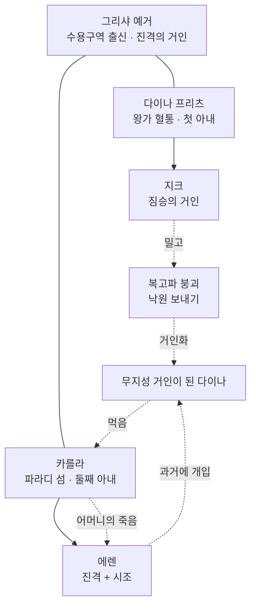

실선은 혈연, 점선은 사건의 흐름입니다. **아들의 밀고가 결국 이복동생의 어머니를 죽인** 구조입니다.

앞서 말씀드린 **닫힌 인과 루프**가 여기서도 돌고 있습니다. 다시 보실 때 이 연결을 염두에 두시면 시즌 3 후반 그리샤 회상편이 훨씬 잘 읽힐 거예요.


---

## Q. 에렌이 왜 복수심으로 다이나가 카를라를 먹게 만들었지?

순서가 반대입니다. **복수심 때문에 그렇게 만든 게 아니라, 그렇게 만들어서 복수심이 생긴 것**입니다.

**부트스트랩 구조**예요.

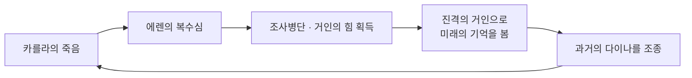

에렌이 미래에서 본 광경에는 **어머니가 먹히는 장면이 이미 들어 있었습니다.** 그 사건이 없으면 조사병단에 들어갈 이유도, 힘을 얻을 이유도, 지금의 자신도 없어집니다. 그래서 **자기 자신을 존재하게 하려고** 그 장면을 직접 실행한 겁니다.

디테일 하나 — 그때 다이나 거인은 **베르톨트 쪽으로 향할 수도 있었습니다.** 그랬다면 베르톨트가 죽고 역사가 통째로 달라졌겠죠. 에렌이 방향을 카를라 쪽으로 **유도**한 겁니다.

가장 중요한 건 **에렌에게 선택권이 있었느냐**입니다. 작품은 여기에 명확한 답을 주지 않아요. 에렌 본인도 "왜 그랬는지 모르겠다"며 울고, 그저 **본 것을 따라갔을 뿐**이라고 말합니다.

앞서 얘기한 아이러니가 여기서 정점을 찍습니다 — **자유를 위해 세상을 태운 인물이, 정작 자기 어머니의 죽음조차 거부하지 못했다**는 것.


---

## Q. 에렌이 미래에서 본 광경이라는게 이해가 안가는데, 에렌은 언제 미래를 본거지?

핵심은 **진격의 거인의 특수 능력**입니다.

### 능력: 미래 계승자의 기억을 본다

거인의 힘은 **'길(Path)'** 이라는 공간으로 모든 유미르의 백성을 시간을 넘어 연결합니다. 보통은 **과거** 계승자의 기억만 물려받는데, 진격의 거인만 **미래** 계승자의 기억까지 볼 수 있어요.

즉 에렌이 보는 건 예언이 아니라 **미래의 자기 자신이 겪은 기억**입니다.

### 언제 봤나 — 세 단계

**1) 1화, 자기도 모르게**
시즌 1 첫 장면에서 에렌이 울면서 깨어나 미카사에게 "긴 꿈을 꾼 것 같아"라고 하죠. 그게 **미래의 기억**이었습니다. 본인은 꿈인 줄 알았고요.

**2) 아버지에게 힘을 받을 때**
그리샤도 진격의 거인이었으니 미래를 봤습니다. 힘을 넘기는 순간 그 기억이 에렌에게 흘러들어옵니다. 다만 이때도 파편적이라 에렌은 이해하지 못해요.

**3) 시즌 4 — 히스토리아와 접촉**
여기서 결정적으로 열립니다. 시조의 힘은 **왕가의 피**가 있어야 발동하는데, 에렌이 왕가 혈통인 **히스토리아의 손을 잡는 순간** 길이 열립니다.

그 자리에서 에렌은 **과거 그리샤의 기억 속으로 들어가**, 왕가를 죽이길 망설이는 아버지 앞에 나타나 말합니다.
> "계속해, 아버지."

시즌 3에서 이미 본 그 학살 장면이, 시즌 4에서 **에렌이 시킨 일이었다**는 게 밝혀지는 구조예요.

### 헷갈리는 이유

**에렌이 여러 시점에 동시에 존재하기 때문**입니다. 길에서는 과거·현재·미래가 한 자리에 있어서, "지금의 에렌"이 "과거의 아버지"에게 말을 겁니다.

그래서 시즌 3에서 본 장면들을 시즌 4에서 **다른 각도로 다시** 보여줍니다. 처음 볼 땐 그리샤 시점, 나중엔 에렌 시점이죠. 다시 보실 때 **"이 장면 아까 봤는데?" 싶으면 대부분 이 재해석 장면**입니다.


---

## Q. 아까 다시 보려면 어디서부터 보기를 추천한다고?

**시즌 3 파트 2의 지하실 편**부터입니다.

거기서 세계관이 통째로 뒤집히고, 시즌 4는 그 전제 위에서 시작하거든요.

다만 지금까지 얘기한 그리샤·다이나·복고파 내용을 제대로 보시려면 **시즌 3 파트 2의 그리샤 회상편**부터 잡는 게 더 낫습니다. 순서는 이렇습니다.

1. **그리샤 회상편** — 수용구역, 여동생 페이, 복고파, 다이나, 지크의 밀고, 에렌 크루거
2. **지하실 편** — 그리샤의 수기로 바깥 세계의 진실 공개
3. **시즌 4** — 마레 시점으로 시작 (낯선 인물 = 마레 전사대, 곧 합류합니다)

보실 때 염두에 두실 것 두 가지:
- **"이 장면 아까 봤는데?"** 싶으면 시점을 바꿔 다시 보여주는 재해석 장면입니다
- 시즌 4 후반의 **길(Path)** 장면에서 시간 순서가 섞이는 건 정상입니다


---

## Q. 시즌1은 안봐?

중간부터 흐름을 놓치셨다고 해서 이미 보신 걸로 이해했습니다. 처음부터 다시 보실 생각이면 시즌 1부터가 당연히 좋고요.

다만 **다시 볼 때의 시즌 1은 전혀 다르게 보입니다.** 복선이 깔려 있거든요.

- **1화 첫 장면** — 에렌이 울며 깨어나는 그 "긴 꿈". 미래의 기억입니다
- **미카사의 두통과 각성** — 아커만 일족 설정으로 나중에 설명됩니다
- **라이너·베르톨트·애니** — 처음부터 정체를 알고 보면 대사와 표정이 완전히 다르게 읽힙니다
- **"저 벽 너머엔 뭐가 있을까"** — 사람이 살고 있다는 걸 알고 보면 아이러니가 큽니다

시간 여유가 되시면 **시즌 1 → 3 → 4 순서로 정주행**을 권합니다. 시즌 2는 라이너 정체 밝혀지는 편이라 짧고 중요하고요.

시간이 없으시면 앞서 말씀드린 **시즌 3 파트 2 그리샤 회상편**부터가 최소 코스입니다.


---

## Q. 중간에 나오는 거인들은 왜 에렌을 도와주는거야?

**시조의 거인의 힘(좌표)** 이 발동한 겁니다.

시즌 2 최종화 장면을 말씀하시는 것 같아요. 에렌이 다이나 거인(미소 거인)에게 잡혔을 때, 소리를 지르자 주변 무지성 거인들이 몰려와 다이나를 공격하죠. 라이너와 베르톨트가 경악하는 그 장면입니다.

**작동 원리**는 이렇습니다.

- 시조의 거인은 **모든 유미르의 백성을 조종**할 수 있습니다. 무지성 거인도 포함이고요.
- 그런데 에렌은 **왕가의 피가 없어서** 평소엔 이 힘을 쓸 수 없습니다.
- 그 순간 에렌이 손을 댄 게 하필 **다이나 — 왕가 혈통**이었습니다.
- 접촉으로 조건이 충족돼 힘이 터진 겁니다.

에렌 본인도 자기가 뭘 했는지 모릅니다. 그래서 이후로 재현하려 해도 안 되고, 조사병단이 "왜 그때만 됐지?"를 계속 파고들죠. 그 답이 **왕가의 피**라는 게 시즌 3에서 밝혀지고, 그래서 **히스토리아**가 중요해지는 흐름으로 이어집니다.

앞서 말한 인과 루프와도 맞물립니다. 하필 어머니를 먹은 그 거인이 왕가 혈통이었고, 그 접촉으로 에렌이 힘에 눈뜬 것 — 전부 에렌 본인이 배치한 셈이니까요.

다른 장면을 말씀하신 거라면 어느 시점인지 알려주세요.


---

## Q. 결국 성안에 살던 사람들이 거인을 두려워했는데, 그들이 거인인거네?

네, 그게 이 작품의 핵심 아이러니입니다.

- 벽 안 사람들은 전부 **엘디아인** — 주사 한 방이면 거인이 됩니다
- 그들이 두려워한 무지성 거인들도 원래 **같은 엘디아인**이었습니다. 마레가 벽 근처에 던져 넣은 사람들이죠
- 심지어 **벽 자체가 초대형 거인 수백만 마리**로 만들어져 있습니다

즉 **거인에게 둘러싸여, 거인이 될 수 있는 사람들이, 거인을 무서워하며 살고 있었던** 겁니다. 진실은 하나도 모른 채로요.

작품 제목의 중의성도 여기 있습니다. **"진격의 거인"** 은 에렌의 힘 이름이자, 벽 안 사람들이 두려워한 대상이자, 결국 세계를 짓밟으러 나아간 존재이기도 하니까요.

첫 화의 "인류는 거인에게 잡아먹혔다"라는 대사가 다시 보면 완전히 다르게 읽히는 이유입니다.

---

## Q. 거인이 되는 주사는 누가 언제 왜 만든거야?

작중에서 "누가 발명했다"는 딱 떨어지는 설명은 안 나옵니다. **정체·기원·용도**로 나눠 보면 정리가 됩니다.

### 정체 — 지성 거인의 척수액

발명품이라기보단 **채취물**입니다. 9개 지성 거인 보유자의 **척수액**을 뽑아 정제한 것이고, 유미르의 백성이 주입받으면 무지성 거인이 됩니다. 마레인은 맞아도 아무 일 없고요.

그래서 "만들었다"보다 **"거인의 힘을 쓰는 방법을 알아냈다"** 에 가깝습니다.

### 기원 — 엘디아 제국

2000년 전 힘이 9개로 갈라진 뒤부터 이미 쓰이던 방식입니다.

- 엘디아 제국이 대륙을 정복할 때 **엘디아인을 거인으로 만들어 적진에 투입**
- 반역자·범죄자 처벌 수단이기도 했음

마레가 새로 개발한 게 아니라, **대전쟁으로 거인 7개를 빼앗으면서 기술까지 넘겨받은** 것입니다.

### 마레의 용도 — 세 가지

| 용도 | 내용 |
|---|---|
| **형벌** | "낙원 보내기". 절벽에서 주사 → 무지성 거인으로 방치. 다이나가 이 케이스 |
| **소모품 병기** | 전장에서 엘디아인 병사를 거인화해 투입 |
| **계승 절차** | 후계자가 주사로 무지성 거인이 된 뒤, 현 보유자를 잡아먹어 지성 거인 계승 |

세 번째가 중요합니다. **에렌이 아버지를 먹은 것도 이 절차**입니다. 그리샤가 에렌에게 주사를 놓고, 거인이 된 에렌이 그리샤를 먹으면서 진격+시조 두 힘을 받습니다.

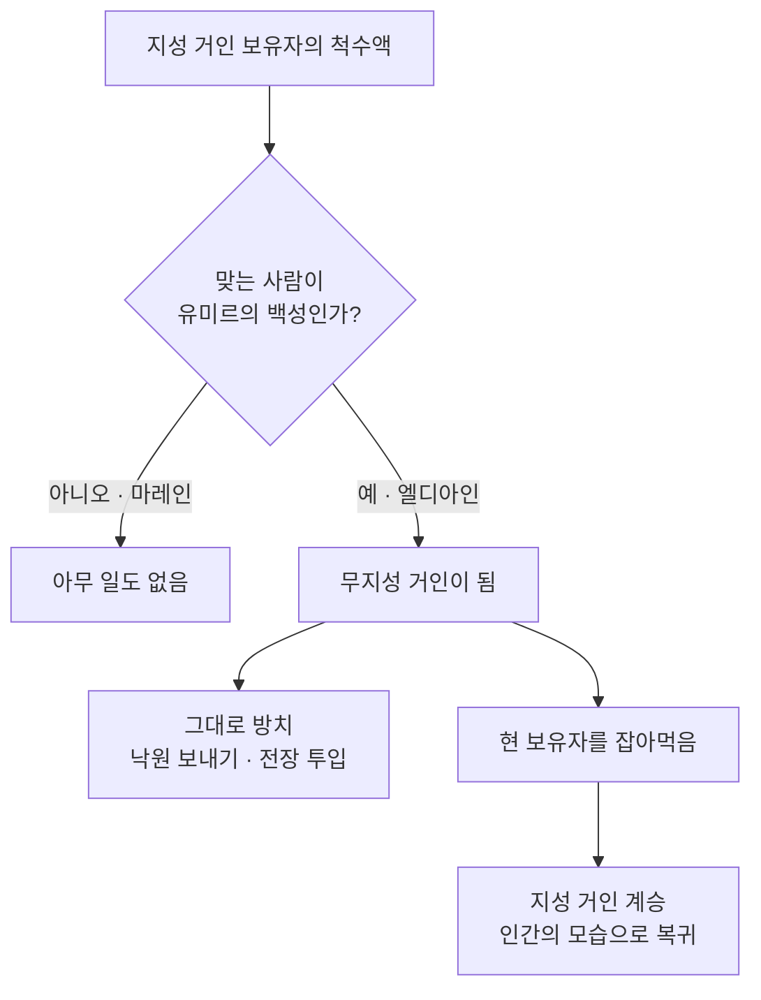

앞서 헷갈렸던 지점이 여기입니다. **주사를 놓는 쪽이 마레 군인이라 그렇지, 맞는 사람은 늘 엘디아인**입니다.

### 왜 이 설정이 무서운가

지크는 이걸 **와인에 타서** 파라디 군 수뇌부에게 먹입니다. 주사기가 없어도 되고, 본인이 소리 한 번 지르면 한꺼번에 거인이 되죠.

**"존재 자체가 무기"** 가 이 부분입니다. 엘디아인은 언제든 남의 손에 병기로 바뀔 수 있고, 그 스위치를 자기가 쥐고 있지 않습니다.

---

## Q. 2000년전 유미르 프리츠는 힘을 왜 얻었고, 힘은 왜 갈라진거고, 대전쟁은 왜 한거야?

### 1. 유미르는 왜 힘을 얻었나 — 사실 **사고**였습니다

- 유미르는 프리츠 왕이 이끄는 부족의 **노예 소녀**
- 돼지를 풀어줬다는 누명을 쓰고 쫓기다 **큰 나무 구멍으로 떨어짐**
- 나무 밑 웅덩이에서 **척추 형태의 정체불명 유기생명체**와 결합해 거인의 힘을 얻음

작품이 이 생명체의 정체를 끝내 설명하지 않습니다. "길(Path)"의 근원 정도로만 나와요.

그 뒤가 더 중요합니다. 힘을 얻은 유미르는 **도망치지 않고 왕에게 돌아갑니다.** 13년간 토목·농경·전쟁에 도구로 쓰이다, 왕을 노린 창을 대신 맞고 죽습니다. 죽은 뒤에도 **2000년간 길에 갇혀 왕의 명령을 계속 수행**합니다.

### 2. 힘은 왜 9개로 갈라졌나 — 왕이 **딸들에게 시신을 먹였습니다**

유미르가 죽자 프리츠 왕이 세 딸(마리아·로제·시나)에게 명령합니다.

> "어머니의 몸을 먹어라. 그러지 않으면 엘디아는 끝난다."

대가 끊기지 않게 **인위적으로 나눠 물려준 것**입니다. 그렇게 유미르의 영혼이 갈라져 **9개의 지성 거인** 계보로 정착합니다. 벽 이름이 **마리아·로제·시나**인 게 이 세 딸에서 왔습니다.

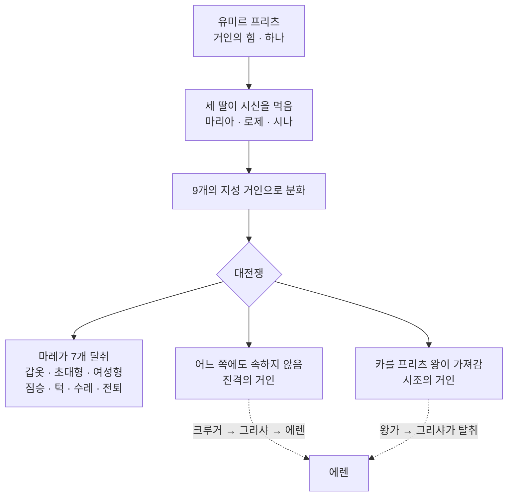

**진격의 거인만 어느 쪽에도 잡히지 않았다**는 게 포인트입니다. 그래서 마레도 파라디 왕가도 통제하지 못했고, 크루거에서 그리샤로 몰래 이어집니다.

### 3. 대전쟁은 왜 일어났나 — **마레가 이긴 게 아닙니다**

원인 쪽:

- 엘디아 제국이 약 1700년간 거인의 힘으로 대륙을 지배 (학살, 강제 혼혈)
- 엘디아 **내부에 왕위 계승 다툼과 파벌 분열** 발생
- 마레가 그 틈을 파고들어 반란, **9개 중 7개 거인을 탈취**

그런데 결정적 이유는 따로 있습니다. **145대 카를 프리츠 왕이 싸우기를 포기했습니다.** 조상의 죄에 죄책감을 느껴 전쟁 의지를 버리고, 시조의 거인을 들고 파라디 섬으로 도망쳐 벽을 세웁니다.

| 남긴 것 | 내용 |
|---|---|
| **부전의 맹세** | 시조의 힘을 전쟁에 쓰지 않겠다는 이념을 후대 왕에게 강제 |
| **기억 조작** | 벽 안 사람들에게서 바깥 세계의 기억을 지움 |
| **땅울림 위협** | "건드리면 벽의 거인들이 세계를 짓밟는다"로 견제 |

마레 공식 역사에는 **타이버 가문이 영웅적으로 승리했다**고 되어 있고, 시즌 4에서 **윌리 타이버가 그게 거짓이었다고 직접 폭로**합니다.

### 다시 볼 때 연결되는 지점

시즌 3에서 **로드 레이스와 히스토리아가 무기력했던 이유**가 이 부전의 맹세입니다. 왕가가 시조의 힘을 갖고도 벽 안 인류를 방치한 게, 게을러서가 아니라 **145대 왕의 이념에 세뇌돼 있었기 때문**입니다.

그리고 에렌이 결국 한 일은 **2000년 만에 유미르를 그 명령에서 풀어준 것**이기도 합니다.

---

## Q. 그 내용들은 애니메이션 어디에서 나와?

정주행 순서가 아니라 **뒤에서 앞을 다시 설명하는 구조**라 흩어져 있습니다.

| 내용 | 애니 위치 | 장면 단서 | 원작 |
|---|---|---|---|
| **유미르 프리츠 기원** (노예, 나무, 척추 생명체) | 파이널 시즌 **Part 2** 중반 | 에렌·지크가 길에서 유미르를 목격 | 122화 「이천년 전의 너에게」 |
| **힘이 9개로 갈라짐** | 위와 같은 편 | 프리츠 왕이 세 딸에게 명령 | 122화 |
| **대전쟁 / 145대 왕의 포기 / 타이버 가문의 거짓** | 파이널 시즌 **Part 1** | 윌리 타이버의 연설, 레벨리오 축제 | 99~100화 |
| **부전의 맹세** | **시즌 3 Part 1** | 로드 레이스와 히스토리아, 동굴 결정체 | 62~69화 |
| **낙원 보내기 / 다이나 거인화** | **시즌 3 Part 2** | 그리샤 회상편, 절벽 장면 | 86~87화 |
| **전장에 거인 투입** | 파이널 시즌 **Part 1 1화** | 중동연합 전투 | 91화 |
| **계승 절차** (에렌이 그리샤를 먹음) | **시즌 3 Part 2** | 지하실 편 직전 회상 | 88~89화 |
| **지크의 와인** | 파이널 시즌 **Part 1 후반~Part 2** | 수뇌부 만찬, 지크의 함성 | 105~113화 |
| **에렌이 그리샤를 조종** | 파이널 시즌 **Part 2** | "계속해, 아버지" | 120~121화 |
| **유미르 해방 / 미카사** | **완결편(The Final Chapters)** | 특별편 2부작 | 138~139화 |

**화수를 안 적은 이유** — 파이널 시즌은 Part 1 / Part 2 / 완결편으로 쪼개져 방영됐고, 스트리밍 플랫폼마다 통합 화수와 시즌별 화수가 다르게 매겨져 있습니다. 숫자보다 **장면 단서로 찾는 게 정확합니다.** 원작 화수는 확실하니, 애니에서 못 찾으면 **만화 122화**부터가 제일 빠릅니다.

---

## Q. 에렌/지크가 길에서 유미르를 만나? 유미르는 처음에 나온 소녀 아니야? 엄청 오래 산건가?

**동명이인입니다.** 이름이 같은 다른 인물이 둘이에요.

| | **유미르 프리츠** | **유미르** (주근깨) |
|---|---|---|
| 시대 | 2000년 전 | 현재 |
| 정체 | 모든 거인 힘의 시조 | 104기 훈련병, **턱의 거인** |
| 관계 | 프리츠 왕의 노예 | 히스토리아(크리스타)의 친구 |
| 등장 | 파이널 시즌 Part 2, 길 장면 | 시즌 1 후반 ~ 시즌 2 |

에렌이 길에서 만나는 건 **유미르 프리츠**입니다.

### "엄청 오래 산 건가" — 반은 맞습니다

**유미르 프리츠**는 육체로는 **13년밖에** 못 살았습니다. 다만 죽은 뒤 **영혼이 길에 2000년간 갇혀** 왕의 명령을 계속 수행합니다. 산 게 아니라 붙잡혀 있었던 것입니다.

**주근깨 유미르**도 나이가 이상합니다.

- 마레 수용구역 출신 엘디아인. 이름 없는 부랑아였음
- 사이비 교주에게 **"유미르 프리츠의 환생"** 이라며 이용당하다 발각
- **낙원 보내기**로 무지성 거인이 돼 **60년간** 떠돎
- 라이너 일행의 동료 **마르셀을 잡아먹고** 인간으로 돌아와 턱의 거인이 됨

104기 동기들보다 **60년 이상 연상**입니다.

### 이름이 같은 건 우연이 아닙니다

둘 다 **이름을 준 사람에게 삶을 바친 인물**입니다.

- 유미르 프리츠는 왕을 위해 **창을 대신 맞고** 죽음
- 주근깨 유미르는 히스토리아를 위해 **스스로 돌아가** 죽음

이 작품은 이렇게 **같은 구조를 다른 인물로 반복**하는 방식을 자주 씁니다.

---

## Q. 유미르 프리츠는 영혼이야?

"영혼"이라기보단 **길(Path)의 중심에 남은 존재**입니다. 작품이 종교적 영혼으로 그리지 않습니다.

### 상태

육체는 13년 만에 죽었지만 사라지지 않고, **길이라는 시공간 밖 공간에 남아** 2000년간 계속 일합니다. 길 장면에서 유미르는 **모래로 끝없이 거인의 몸을 빚고 있습니다.** 무표정하게, 말도 거의 없이요.

### 이게 왜 중요한가 — 거인의 힘의 실체

- 모든 유미르의 백성은 길로 연결돼 있고, 그 **교차점이 유미르가 있는 자리** = **좌표**
- 누가 거인화할 때, 힘이 계승될 때, 그 몸을 실제로 **만들어주는 게 유미르**
- 즉 "거인의 힘"은 초자연 현상이 아니라 **유미르가 2000년째 하고 있는 일의 결과**

시조의 거인이 최강인 이유도 힘이 세서가 아니라 **좌표에 접근해 유미르에게 명령할 수 있어서**입니다.

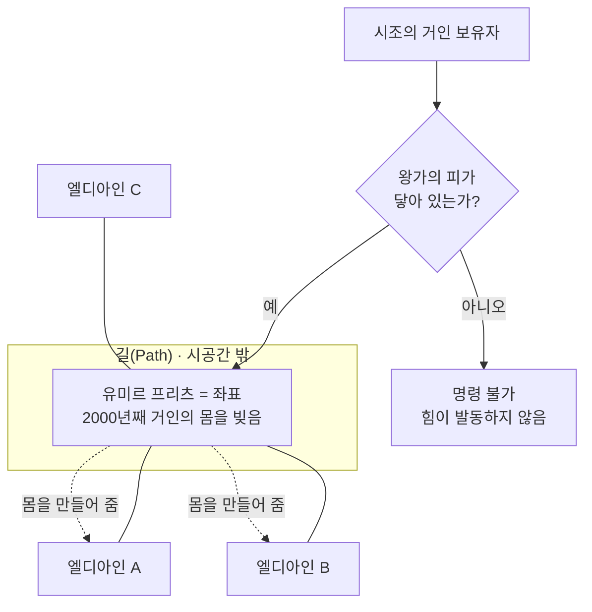

에렌이 **히스토리아의 손을 잡아야 했던 이유**, 지크가 **왕가 혈통이라 필요했던 이유**가 전부 가운데 마름모입니다.

### 왕가의 피가 필요했던 진짜 이유

유미르가 **프리츠 왕에게 복종하도록 묶여 있기 때문**입니다. 왕가 혈통이 명령해야 움직입니다. 145대 왕의 **부전의 맹세**도 결국 유미르에게 걸어둔 족쇄고, 에렌이 히스토리아의 손을 잡아야 했던 것도 이 조건 때문입니다.

### 에렌은 유미르를 뭐라고 봤나

**노예**로 봤습니다. 길에서 왜 2000년간 명령을 따랐느냐고, 왕을 사랑한 거냐 증오한 거냐고 묻습니다. **작품은 답을 주지 않습니다.**

유미르가 풀려나는 건 마지막입니다. **미카사가 사랑하는 에렌을 스스로 죽이는 선택**을 보고서예요. 사랑에 종속되는 것 말고 다른 길이 있다는 걸 그때 처음 본 것입니다.

이 작품의 마지막 층은 **"2000년간 갇혀 있던 한 소녀를 놓아주는 이야기"** 입니다.

---

## Q. 좌표 / 유미르가 몸을 만들어준다는 건 어느 장면에 나와?

**한 장면에 다 나오지 않습니다.** 세 군데에 흩어져 있고, 마지막 한 줄은 종합한 해석입니다.

### 1. "좌표" — 용어만 먼저 등장

**시즌 2 최종화.** 에렌이 다이나를 만지고 무지성 거인들이 몰려든 직후, 라이너와 베르톨트가 **"좌표"** 라는 말을 꺼냅니다. 이때는 단어만 나오고 정체는 안 알려줍니다.

시즌 3에서 "왕가의 피가 있어야 한다"까지 밝혀지고, **실제로 좌표가 어떤 장소인지는 파이널 시즌 Part 2**에 가서야 화면에 나옵니다.

### 2. "유미르가 몸을 만들어준다" — **지크의 부활 장면**

가장 직접적인 증거입니다. **파이널 시즌 Part 2 초반**, 지크가 폭사한 뒤 길에서 되살아나는 장면에서 **흙으로 자기 몸을 빚어주고 있는 소녀**를 목격합니다. 원작 116화 전후. 지크 본인도 그게 누군지 몰라 어리둥절해합니다.

### 3. "2000년째" — **유미르 과거편**

**원작 122화 「이천년 전의 너에게」.** 애니는 파이널 시즌 Part 2 중반. 유미르가 죽은 뒤에도 길에 남아 계속 거인을 빚어온 모습이 나오고, 에렌이 그 자리에 들어가 말을 겁니다.

### 4. 주의 — 표현 구분

작품이 "노동"이라는 단어를 쓰진 않습니다. 화면에 나오는 건 **소녀가 무표정하게 흙을 빚는 모습**이고, "이게 거인의 힘의 정체구나"는 위 세 장면을 이어 붙여야 나오는 결론입니다. 다만 에렌이 유미르를 **"노예"** 라고 부르는 건 실제 대사입니다 (122화 이후 길 장면).

### 정리

이 설정은 **파이널 시즌 Part 2가 통째로 답을 주는 구간**입니다. 지크 부활 → 에렌과 함께 길 진입 → 유미르 과거 공개 순으로 이어집니다. 원작 기준 **116~122화**가 가장 정확한 좌표입니다.

---

## Q. 에렌이 거의 죽을뻔할 때 지크와 접촉해서 좌표에 닿잖아. 그 전에도 닿을 기회가 많았는데 왜 막판에야 접촉했지?

**접촉 조건이 "손만 닿으면"이 아니기 때문**입니다.

### 1. 진짜 조건 — 왕가 혈통이 거인화 상태여야 한다

시조의 힘이 발동하려면 `시조 보유자(에렌) + 거인화한 왕가 혈통`이어야 합니다. 에렌은 왕가 피가 없어서 열쇠를 빌려야 하는데, 그 열쇠가 **인간 모습일 땐 작동하지 않습니다.**

- **시즌 2 다이나**: 에렌 거인 상태 + 다이나는 왕가 피를 가진 무지성 **거인** → 조건 충족, 좌표 발동
- **리베리오 지하에서 에렌·지크가 마주 앉아 대화한 장면**: 둘 다 **인간** → 악수를 했어도 아무 일도 안 일어남

"닿을 기회가 많았다"고 느껴지는 장면들은 대부분 **조건이 안 되는 기회**였습니다.

### 2. 그 외에 막고 있던 것 3가지

| 누가 | 왜 막았나 |
|---|---|
| 조사병단 (한지·리바이) | 접촉 = 시조 발동을 알고 **의도적으로 격리**. 에렌은 지하 감옥, 지크는 리바이가 데리고 **숲으로** |
| 지크 | 접촉 순간 **에렌의 의지**가 발현될 수 있음을 알아서, 먼저 형제로서 안락사 계획에 끌어들이려 함 (105·114화 크사버 배경) |
| 에렌 | 미래 기억으로 이 순간을 **이미 봤기 때문에** 서두를 이유가 없었음 |

리바이가 굳이 지크를 시간가르나 숲까지 끌고 간 것이 이 격리의 핵심 장면입니다.

### 3. 그래서 그 장면이 극적인 이유 — 아이러니

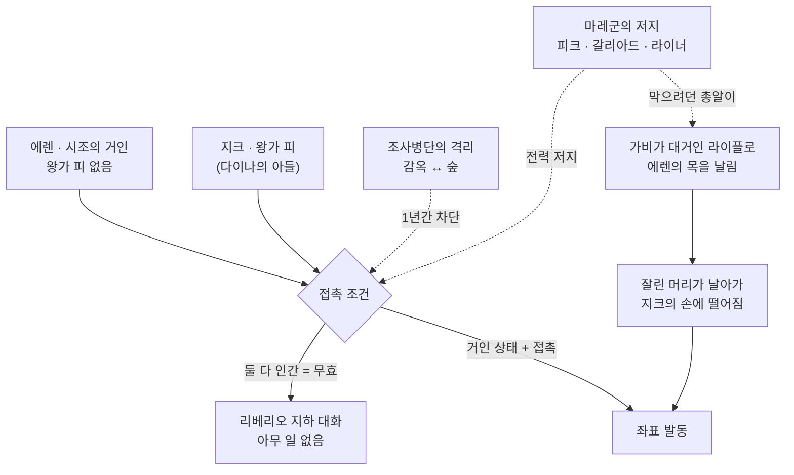

에렌과 지크가 서로를 향해 달려가고 지크가 손을 뻗는 순간, **마레 쪽 소녀 가비가 에렌의 목을 날립니다.** 그런데 잘린 머리가 정확히 **지크의 손에 떨어집니다.**

> 조사병단이 1년간 막았고 마레가 전력으로 막으러 온 접촉이, **막으려던 마레의 총알 때문에** 성사됩니다.

### 위치

원작 **119화 「두 형제」** 끝 → **120화 「덧없는 순간」**. 애니는 **파이널 시즌 Part 2 19화**.

접촉 직후에도 바로 에렌 뜻대로 되진 않습니다. 처음엔 **지크가 통제권**을 쥐고 에렌에게 그리샤의 기억을 보여주며 설득하고, 에렌이 좌표의 유미르를 설득해 **122화 끝에서야** 시조로 각성합니다.

---

## Q. 에렌은 이후에 머리만 남은 상태로 돌아다니는 거야?

아니요 — 정확히는 **머리만 남은 채, 유미르가 만들어준 거대한 몸에 붙어서** 끝까지 갑니다.

### 길에서는 시간이 멈춰 있다

119화 끝(목이 날아감) ~ 122화(유미르 설득)까지 전부 **현실에서는 한순간**입니다. 가비가 총을 쏜 직후, 그 자리에서 벌어지는 일입니다.

### 몸은 유미르가 만들어 준다

에렌이 유미르를 설득해 시조로 각성하는 순간, 유미르가 몸을 빚어 줍니다. 앞의 **"유미르가 2000년째 거인의 몸을 빚는다"** 설정이 여기서 회수됩니다.

- 잘린 목에서 **거대한 척추**가 뻗어 나오고, 지네처럼 갈비뼈가 이어진 **해골 형태의 거인**
- 크기는 벽 거인보다 훨씬 큼
- **에렌의 머리는 그 척추 맨 앞에 붙어 있음** — 인간 몸은 영영 돌아오지 않음

그러니 "머리만 남아 돌아다닌다"는 감각이 틀린 게 아닙니다. 가비의 총알 이후 에렌은 두 번 다시 원래 몸을 갖지 못합니다.

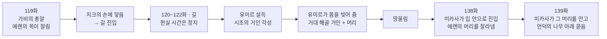

### 결말까지 이어진다

마지막에 아르민이 초대형 거인으로 자폭하고, **미카사가 시조 거인의 입 안으로 날아 들어가** 척추에 붙은 에렌의 머리를 찾아내 목을 잘라내고 입을 맞춥니다.

> 마지막에 미카사가 품에 안고 있는 것이 **에렌의 잘린 머리**입니다. 119화에서 잘린 바로 그 머리요.

### 위치

- 몸을 얻는 장면 — 원작 **122~123화** / 애니 파이널 시즌 Part 2 후반
- 최후 — 원작 **138~139화** / 애니 파이널 시즌 Part 3 · 극장판 *The Last Attack*

---

## Q. 지크는 왜 엘디아인을 안락사시키려고 한 거야?

핵심은 **"엘디아인은 태어나는 순간 이미 저주받았다"** 는 결론입니다. 죽이는 게 아니라 **더 이상 태어나지 않게 하는 것** — 100년 뒤 엘디아인이 자연히 사라지면 거인 문제도 세계의 증오도 끝난다는 계획입니다.

### 1. 아버지 그리샤 — 도구로 길러짐

지크는 어릴 때부터 **엘디아 부흥파의 도구**로 양육됩니다. 시조를 되찾으라는 아버지의 꿈을 위해 훈련받고, 재능이 없으면 가족 전체가 죽는 상황에 몰립니다. **자기 자신으로 사랑받은 적이 없습니다.**

### 2. 톰 크사버 — 진짜 아버지 역할, 그리고 사상의 씨앗

전대 짐승 거인 보유자. 지크와 **캐치볼을 해준** 유일한 어른이고, 부모를 밀고하라고 알려줘서 지크를 살립니다.

계획의 출발점은 크사버 본인의 이야기입니다.

> 마레인 아내와 아들이 있었는데, 자신이 **엘디아인임을 밝히자** 아내가 **아들을 죽이고 스스로 목숨을 끊었습니다.**

여기서 "엘디아인은 존재 자체가 비극"이라는 결론에 이릅니다. 다만 크사버에겐 **왕가의 피가 없어서** 실행할 수 없었고, 지크에겐 있었습니다 (어머니 다이나 프리츠).

### 3. 논리 — 학살이 아니라 자비

| 전제 | 결론 |
|---|---|
| 엘디아인은 태어나면 무기 아니면 증오의 대상이 된다 | 태어나는 것 자체가 고통 |
| 세계가 먼저 손을 대면 폭력적인 몰살이 된다 | 어차피 끝은 정해져 있다 |
| 시조의 힘으로 생식 능력만 없애면 된다 | 아무도 죽이지 않고 100년 안에 조용히 끝난다 |

지크는 이것을 **구원**이라고 불렀습니다. 마지막 세대는 평화롭게 살다 죽으면 된다는 것입니다.

### 4. 진짜 동기 — 자기 자신

밑바닥에 깔린 건 **"나는 태어나지 말았어야 했다"** 입니다. 지크는 자기 고통을 민족 전체에 투사합니다. 114화 제목이 「유일한 구원」인데, 그 구원은 사상이 아니라 **크사버와 캐치볼하던 그 순간**입니다.

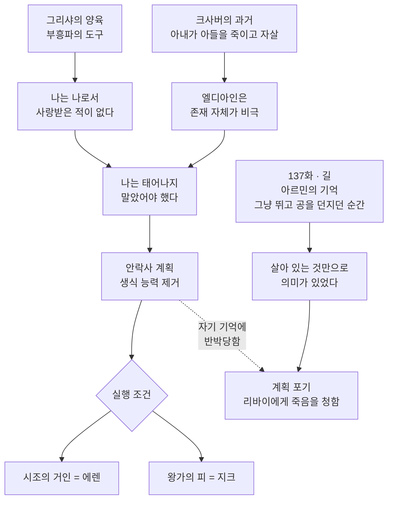

### 마지막에 지크는 계획을 버린다

137화. 길에서 아르민의 기억을 보다가 **그냥 뛰는 것, 공을 던지는 것**만으로도 좋았던 순간들을 보고 깨닫습니다.

> "그저 살아 있는 것만으로도 의미가 있었구나."

그리고 스스로 계획을 포기하고 **리바이에게 죽여달라고** 몸을 내밉니다. 자기 사상을 자기 기억으로 반박당한 셈입니다.

### 위치

- 계획 설명 — 원작 106~107화
- 배경(크사버·캐치볼) — 원작 **114화 「유일한 구원」** / 애니 파이널 시즌 Part 2
- 포기 — 원작 **137화**

---

## Q. 에렌은 왜 땅울림을 했고, 벽 속에 숨겨둔 거인은 누구였어?

두 개가 한 덩어리입니다. **벽 속 거인이 곧 땅울림의 정체**라 그것부터 봐야 합니다.

### 1. 벽 자체가 거인이다

마리아·로제·시나 세 벽은 **초대형 거인 수천만 체**가 어깨를 맞대고 선 채 경화된 덩어리입니다.

**누구였나 — 엘디아인 본인들입니다.** 145대 **카를 프리츠 왕**이 시조의 힘으로 **자기 백성을 초대형 거인으로 바꿔** 벽을 만들었습니다. 지켜주던 벽이 사실 같은 민족의 몸이었습니다.

| 항목 | 내용 |
|---|---|
| 만든 사람 | 145대 카를 프리츠 왕 (약 100년 전) |
| 재료 | 시조의 힘으로 거인화시킨 **유미르의 백성** |
| 수 | 수천만 체 |
| 목적 | 바깥 세계를 향한 **억지력** — "공격하면 다 풀어 세상을 밟겠다" |
| 함정 | 왕은 **부전의 맹세** 때문에 쓸 생각이 없었음 → **허세로 100년** |
| 은폐 | 벽 안 사람들의 **기억을 전부 삭제**, 벽교가 비밀을 지킴 |

**처음 밝혀지는 장면**: 시즌 2 1화. 부서진 벽 틈으로 **햇빛이 거인의 얼굴에 닿고**, 벽교의 닉 신부가 필사적으로 가립니다.

### 2. 에렌은 왜 땅울림을 했나 — 작품이 답을 하나로 주지 않는다

139화에서 아르민이 묻자 에렌이 두 가지를 말합니다.

**표면 — 파라디와 친구들을 위해**

세계 전체가 파라디를 없애려 연합한 상태였고, 위협만으로는 증오가 멈추지 않는다고 판단합니다. 바깥 인류의 **약 80%** 를 밟아 파라디가 몇 세대 버틸 시간을 벌려 했습니다. 그리고 **친구들이 자기를 막게** 설계했습니다 — 세계를 구한 영웅이 되면 파라디도 지킬 수 있으니까요.

**진짜 — "그냥 그러고 싶었어"**

> 바다 너머에 **자유**가 있다고 믿었는데, 가보니 **사람이 가득했다.**

시즌 3 마지막 바다에서의 *"저놈들을 다 죽이면 우리는 자유로워질까?"* 는 **비유가 아니라 진심**이었습니다. 어릴 때 아르민의 책에서 본 텅 빈 세계를 원했고, 바깥에 사람이 산다는 건 희망이 아니라 **실망**이었습니다. 밟는 동안 **자유를 느꼈다**고 인정합니다. "파라디를 위해"는 **자기합리화에 가깝다**는 것이 작품의 결론입니다.

**세 번째 층 — 미래 기억의 루프**

에렌은 **이미 본 미래를 향해 움직였을 뿐**이기도 합니다. 왜 했냐는 질문에 본인도 **"모르겠다"** 고 합니다. 자유를 외친 인물이 **가장 자유롭지 않았다**는 것이 마지막 아이러니입니다.

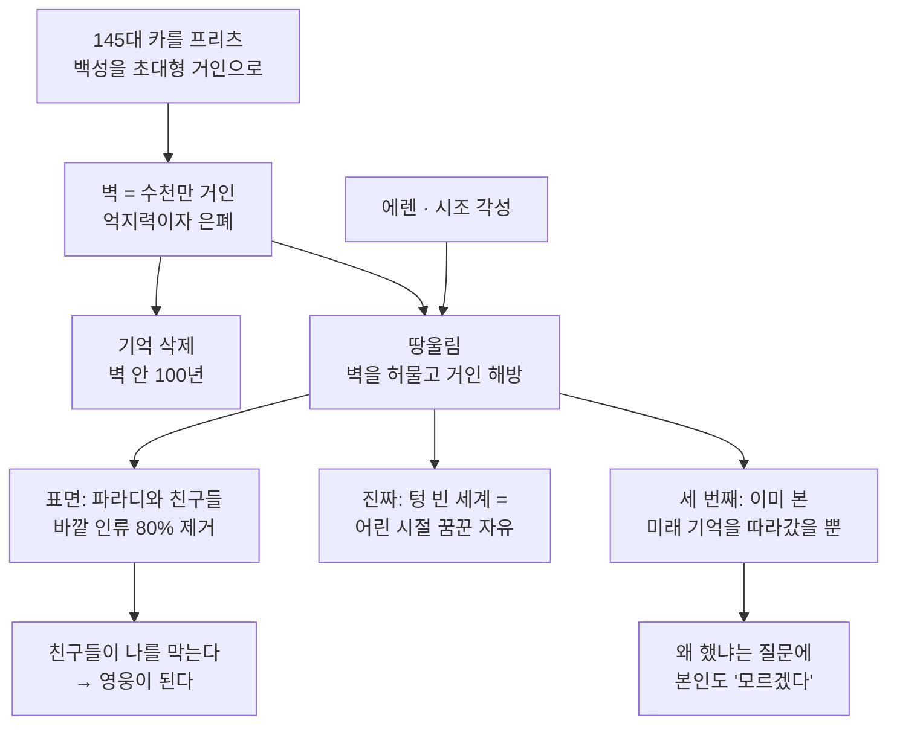

### 위치

- 벽 거인 정체 — 시즌 2 1화(첫 등장) → 시즌 3 로드 레이스 편(전모)
- 땅울림 발동 — 원작 122~123화
- 에렌의 고백 — 원작 **139화**

---

## Q. 시즌 2까지는 잘 봤는데 시즌 3부터 내용이 방대해서 힘들어. 팁이 있을까?

시즌 3부터 힘든 이유는 **작품의 장르가 바뀌기 때문**입니다.

- 시즌 2까지 — "인류 vs 거인" 액션. **보여주는 것만 따라가면** 됨
- 시즌 3부터 — 정치 드라마 + 역사물. 정보가 **회상과 문서로** 전달됨

보는 방식 자체를 바꿔야 합니다.

### 팁 1. 따라갈 축을 "인물"에서 "질문"으로

각 구간은 **질문 하나에 답하는 구조**입니다. 이것만 붙잡고 있으면 세부가 흐려져도 흐름은 안 놓칩니다.

| 구간 | 이 구간이 답하는 질문 | 답 |
|---|---|---|
| 시즌 1 | 거인은 어디서 왔나 / 지하실에 뭐가 있나 | (질문만 제시) |
| 시즌 2 | 벽 안에 배신자가 있다 | 라이너·베르톨트·유미르의 정체 |
| 시즌 3 Part 1 | **벽 안은 누가 지배하나?** | 왕정은 가짜, 레이스 가문이 시조 보유 |
| 시즌 3 Part 2 | **벽 밖엔 뭐가 있나?** | 인류는 멸망하지 않았다. 우리가 '섬의 악마' |
| 시즌 4 Part 1 | **우리를 미워하는 쪽 사정은?** | 마레 시점, 가비·팔코 |
| 시즌 4 Part 2 | **거인의 힘의 정체는?** | 길, 유미르, 좌표 |
| 시즌 4 Part 3 | **에렌을 막을 것인가** | 알리안스와 결말 |

### 팁 2. 새 인물은 이름 말고 소속만 체크

세 덩어리뿐입니다.

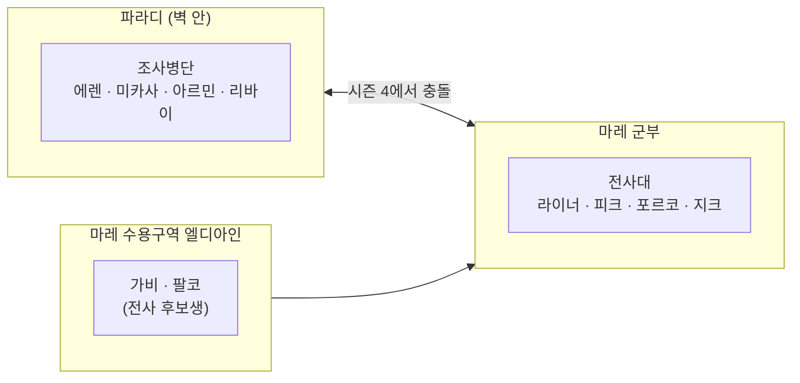

시즌 4에서 낯선 인물이 쏟아지는 건 **시점이 적국으로 넘어가서**지, 인물이 복잡해서가 아닙니다.

### 팁 3. 9개 거인 보유자 표를 옆에 두고 볼 것

혼란의 절반이 여기서 옵니다.

| 거인 | 계승 순서 | 최종 보유 |
|---|---|---|
| **시조의 거인** | 유미르 → 프리츠 왕가 → 우리/프리다 레이스 → 그리샤 → **에렌** | 에렌 |
| **진격의 거인** | 에렌 크루거 → 그리샤 → **에렌** | 에렌 |
| **전추(망치)의 거인** | 타이버 가문 → 라라 타이버 → **에렌** | 에렌 |
| **초대형 거인** | 베르톨트 후버 → **아르민** | 아르민 |
| **갑옷의 거인** | **라이너 브라운** | 라이너 |
| **여성형 거인** | **애니 레온하트** | 애니 |
| **짐승의 거인** | 톰 크사버 → **지크 예거** | 지크 |
| **턱의 거인** | 마르셀 갈리아드 → 유미르 → 포르코 갈리아드 → **팔코 그라이스** | 팔코 |
| **차력(수레)의 거인** | **피크 핑거** | 피크 |

에렌이 혼자 **3개**를 가진 것이 후반부 힘의 균형을 이해하는 열쇠입니다.

### 팁 4. 회상이 시작되면 "지금 누구의 기억인가"를 체크

시즌 3부터 회상이 **정보 전달의 주 수단**입니다. 그리샤 수기 / 에렌 크루거 / 톰 크사버 / 유미르 — 이걸 표시해두지 않으면 현재 시점과 섞입니다.

### 팁 5. 몰아보지 말고 분기점에서 끊을 것

**지하실 편 끝** → **마레편 끝** → **길 진입**. 특히 지하실 편은 작품의 **전후반 분기점**이라 거기서 한 번 끊고 정리하는 걸 권합니다.

> 참고: **시즌 3 Part 1은 거인이 거의 안 나옵니다.** 사실상 정치 스릴러입니다. "왜 재미가 없지"가 아니라 "지금은 정치편"이라고 알고 보면 훨씬 덜 지칩니다.

관련: [다시 보려면 어디서부터](#q-아까-다시-보려면-어디서부터-보기를-추천한다고) 항목 참고.

---

## Q. 에렌은 왜 마레에 잠입했고, 갑자기 거인화한 이유는? 차력 거인과는 왜 싸웠어?

세 개가 한 장면에 엮여 있습니다. (원작 100~106화 / 애니 파이널 시즌 Part 1 5~8화)

### 1. 왜 잠입했나

에렌은 **다리를 잃은 상이군인 "크루거"** 로 위장해 마레의 **레벨리오 수용구역**에 숨어 있었습니다. 병원에서 팔코 그라이스와 친해지고, **팔코에게 편지 심부름을 시켜** 마레에 들어와 있던 조사병단과 연락했습니다.

| 목적 | 내용 |
|---|---|
| 지크와 접촉 | 안락사 계획에 동조하는 척하며 직접 만남 |
| 타이버 가문의 축제 | 세계 각국 기자·대사와 마레 수뇌부가 **한자리에 모이는 날** |
| 전추의 거인 탈취 | 라라 타이버를 잡아먹는 것이 실제 성과 |
| 라이너 | 직접 마주보기 |

**조사병단의 정식 작전이 아니었습니다.** 에렌이 거의 독단으로 먼저 움직였고 한지와 조사병단이 뒤따라간 형태입니다.

### 2. 왜 그 순간 거인화했나

**윌리 타이버가 무대에서 파라디에 선전포고하는 바로 그 순간**이었습니다. 에렌은 그 아래 지하에서 **라이너 옆에 앉아** 연설을 듣다가 말합니다.

> **"나랑 너는 똑같아."**

둘 다 사명을 이유로 남의 마을을 짓밟았다는 뜻입니다. 라이너가 죄책감에 무너지는 그 순간 에렌이 거인화해 무대 아래에서 솟아오릅니다.

| 이유 | 내용 |
|---|---|
| 정치적 타이밍 | 세계가 보는 앞에서 선전포고 → **즉시 반격**. "섬의 악마"를 세계 앞에서 실증 |
| 표적 밀집 | 마레 수뇌부와 각국 요인이 한 광장에 |
| 전추의 거인 | 라라 타이버가 **모습을 드러내야** 잡아먹을 수 있음 |

### 3. 차력의 거인과는 왜 싸웠나

에렌이 노린 상대가 아니라 **마레의 반격**이었습니다.

습격 초반 조사병단은 **스파이를 써서 차력(피크)과 턱(갈리아드)을 깊은 구덩이에 빠뜨려** 거인화를 막아뒀습니다. 그런데 **둘이 탈출해서** 전장에 합류합니다.

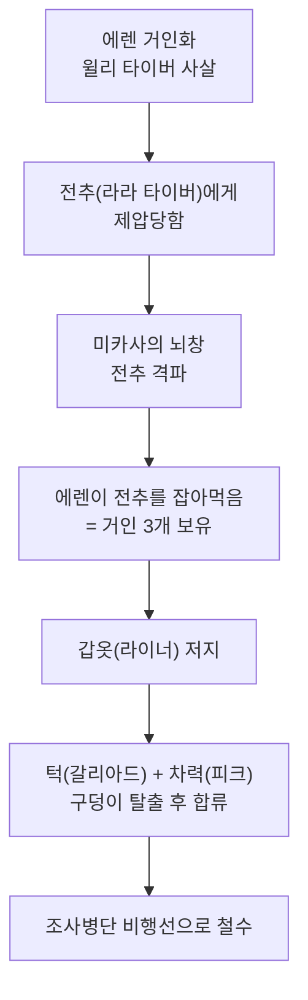

차력 거인은 네 발로 기며 **등에 대포·기관총을 싣는 이동 포대**입니다. 전투력보단 화력 운반이 역할이라, 에렌에겐 **철수를 방해하는 장애물**이었습니다.

---

## Q. 전추 거인의 '전추'가 무슨 뜻이야? 그리고 팔코의 역할은?

### 전추(戰鎚)

**戰(싸움 전) + 鎚(쇠망치 추)** — 전투용 망치. 영어명이 **War Hammer Titan**이고, 중세에 갑옷 입은 상대를 부수던 무기입니다. 라라 타이버의 거인이 경화로 **거대한 망치**를 만들어 휘둘러서 붙은 이름입니다.

다른 이름들도 같은 식입니다.

| 이름 | 한자 | 뜻 |
|---|---|---|
| 전추 | 戰鎚 | 전투용 망치 |
| 차력 | 車力 | 수레 끄는 힘 = 이동 포대 |
| 진격 | 進擊 | 앞으로 나아가며 친다 |

### 팔코 그라이스 — 역할이 네 번 바뀐다

**1) 마레의 전사 후보생 — 가비의 경쟁자**

표면적으로는 갑옷의 거인 계승권을 놓고 가비와 경쟁합니다. 그런데 진짜 이유가 반대입니다.

> 팔코는 **자기가 계승해서 가비를 구하려고** 했습니다. 거인을 물려받으면 **13년 만에 죽으니까요.**

**2) 에렌에게 이용당한 편지 심부름꾼**

병원에서 만난 "크루거"(= 에렌)의 편지를 선의로 배달했고, 그게 조사병단과의 연락망이었습니다. 습격 후 **자기가 공범이었다**는 걸 알고 무너집니다.

**3) 턱의 거인 계승 — 날 수 있는 거인**

지크의 **척수액이 든 와인**을 마신 상태에서 지크의 절규로 무지성 거인이 되고, **포르코 갈리아드를 잡아먹어** 턱의 거인을 계승합니다. 이 턱의 거인은 **날개가 달려 있습니다.** 지크의 척수액으로 만들어진 영향으로 설명되며, 이름 **팔코(Falco = 매)** 와 맞아떨어지는 복선이기도 합니다.

**4) 최종 결전의 유일한 이동 수단**

팔코의 진짜 존재 이유입니다. 땅울림 중인 시조의 거인에게 **접근할 방법이 비행밖에 없었고**, 알리안스를 태우고 날아간 것이 팔코입니다. 팔코가 없었으면 에렌을 막는 것 자체가 불가능했습니다.

### 주제적 역할

가비와 함께 **"적의 얼굴"을 보여주는 장치**입니다. 시즌 4에서 시점이 마레 쪽 아이들로 넘어가는 건, 관객이 **누가 우리 편인지 다시 정의하게** 만들려는 설계입니다. 시즌 1의 에렌·미카사·아르민과 **정확히 같은 위치**에 있는 아이들입니다.

---

## Q. 팔코는 어떻게 지크의 척수액이 든 와인을 마신 거지?

**마신 게 아니라 뒤집어썼습니다.** 사고였습니다.

### 와인 계획 자체 — 지크와 예레나의 설계

1. **마레 의용병단이 파라디로 올 때 와인을 잔뜩 싣고 옵니다** — 니콜로의 말로는 "어떤 임무에도 필요 없을 만큼 많은 양"
2. 그 와인에 **지크의 척수액**이 섞여 있음
3. 마레군 포로였던 요리사 **니콜로**가 파라디 고위층 전용 식당을 맡고, **예레나가 "이 와인을 고위 장교들에게 내라"** 고 지시
4. 목적 — **파라디 수뇌부 전원을 지크의 인질로**. 지크가 소리 지르면 전부 거인이 된다

니콜로는 나중에야 자기가 무슨 짓을 했는지 깨닫습니다.

### 팔코가 삼키게 된 경위

니콜로가 **사샤의 가족과 가비·팔코를 식사에 초대한 자리**였습니다.

그 자리에서 **가비가 "내가 사샤를 쐈다"** 고 고백합니다. 격분한 니콜로가 **와인병을 들어 가비에게 휘두릅니다.**

> **팔코가 가비를 감싸며 뛰어듭니다.** 병이 팔코의 머리에서 깨지고, 흘러내린 와인이 입으로 들어갑니다.

마시겠다고 마신 게 아니라, **가비를 지키려다 머리에 뒤집어쓴 것**입니다.

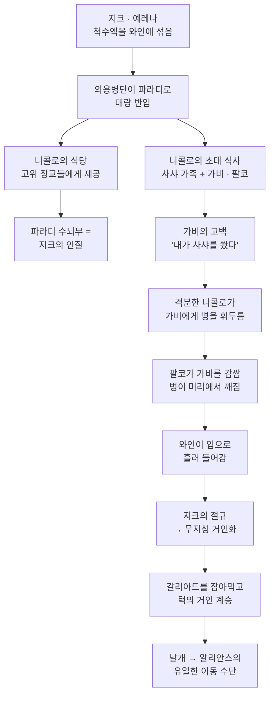

### 아이러니가 두 겹

팔코가 원래 전사 후보생이 된 이유가 **"가비를 거인으로 만들지 않으려고"** 였는데,

- 가비를 몸으로 감싼 그 행동 때문에 → **팔코 본인이 거인이 되고**
- 그 거인이 날개를 갖게 되어 → **에렌을 막는 유일한 수단**이 됩니다

지키려던 행동이 자기를 저주로 끌고 들어가고, 그 저주가 결국 세계를 구합니다.

### 위치

병이 깨지는 장면과 정체가 밝혀지는 건 애니 **파이널 시즌 Part 1 13화 「숲의 아이들」**, 원작 **111화** 전후.

---

## Q. 에렌이 과거의 그리샤에게 개입하는 장면은 회상이야, 실제로 과거로 간 거야?

**셋 다 아니고 네 번째입니다.** 그리샤 쪽에서 보면 **실제로 일어난 일**이고, 에렌 쪽에서 보면 **길(Path)을 통한 간섭**입니다.

### 회상이 아닌 이유

회상이라면 그리샤가 **반응하지 않아야** 합니다. 그런데 그리샤는 에렌과 지크를 **보고, 놀라고, 말을 겁니다.** 지크가 손을 붙잡자 뿌리치고, 지크에게 사과하고, 에렌에게 미카사와 아르민을 지켜달라고 합니다.

즉 **그리샤 입장에서는 그 순간 실시간으로 겪은 사건**입니다.

### 시간 여행도 아닌 이유

에렌의 **몸이 간 것이 아닙니다.** 간 것은 **의지와 기억**입니다. 가능한 이유는 진격의 거인의 고유 능력입니다.

> 진격의 거인은 **미래 계승자의 기억을 볼 수 있습니다.**

그리샤는 당시 진격의 거인 보유자였으므로 **미래의 에렌이 보낸 것을 받을 수 있었습니다.** 에렌이 과거로 간 것이 아니라 **과거의 그리샤가 미래를 받은 쪽**이고, 통로는 시공간 밖인 **길**입니다.

### 인과 루프

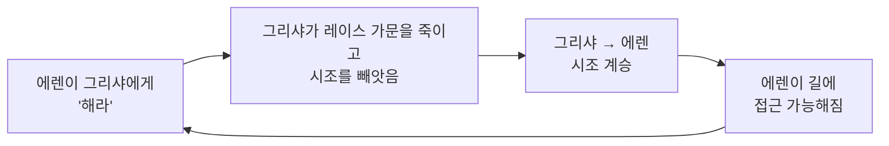

**시작점이 없습니다.** 누가 먼저 결정했는지를 물을 수 없는 구조입니다. 에렌이 "왜 이걸 했는지 모르겠다"고 말하는 이유의 절반이 여기 있습니다.

### 같은 원리의 복선

**에렌 크루거**가 시즌 3 Part 2에서 그리샤에게 *"미카사, 아르민... 그리고 네 친구들을 구해줘"* 라고 합니다. **그 시점에 존재하지도 않는 아이들의 이름**입니다.

크루거도 진격의 거인 보유자였기 때문에 **미래의 에렌 기억이 새어 들어온 것**이고, 이 장면이 121화에서 회수됩니다.

### 위치

- 그리샤 개입 — 원작 **121화 「미래의 기억」** / 애니 파이널 시즌 Part 2
- 크루거 복선 — 시즌 3 Part 2 그리샤 회상편

관련: 「에렌이 미래에서 본 광경이라는게 이해가 안가는데」 항목과 이어집니다.

---

## Q. 그리샤는 어떤 방식으로 시조를 빼앗았어? 히스토리아는 레이스 가문이야? 프리츠에서 가문이 바뀐 건가?

세 개가 연결돼 있어서 뒤에서부터 푸는 게 깔끔합니다.

### 1. 프리츠 → 레이스, 가문이 바뀐 게 맞다

145대 **카를 프리츠**가 파라디로 옮기며 한 일입니다.

- **프리츠라는 이름을 버리고 `레이스`로 개명**하고, 벽 안에서 **하급 귀족인 척** 숨어 삶. 시조는 이 집안이 대대로 계승
- 대신 **가짜 프리츠 왕가**를 세워 표면상의 왕으로 내세움 — 시선 돌리기

그래서 "왕"이라는 말이 세 군데로 나뉩니다.

| | 정체 | 시조 | 대표 인물 |
|---|---|---|---|
| **레이스 가문** | 벽 안의 **진짜 왕가** (숨은 귀족) | **보유** | 우리 → 프리다 → 로드 → 히스토리아 |
| **프리츠 왕가** (벽 안) | **가짜 · 허수아비** | 없음 | 시즌 3에서 밀려난 왕 |
| **프리츠 가문** (마레) | 대륙에 남은 **왕가 방계** | 없음 | 다이나 프리츠 → **지크** |

지크의 왕가 혈통은 세 번째 줄에서 옵니다.

### 2. 히스토리아는 레이스가 맞다

**로드 레이스의 사생아**입니다. 어머니 알마는 하녀였고, 그래서 농장에서 **크리스타 렌즈**라는 가명으로 숨어 자랐습니다.

**프리다가 이복 언니**입니다. 몰래 찾아와 놀아주고는 매번 **시조의 힘으로 히스토리아의 기억을 지웠습니다.** 나중에 기억이 돌아오는 게 그래서입니다.

그리샤의 학살로 레이스가 몰살 → 로드마저 죽으면서 → **히스토리아가 유일하게 남은 왕가 혈통**이 되어 여왕이 됩니다.

### 3. 그리샤는 잡아먹어서 빼앗았다

**845년, 벽 마리아가 뚫리던 바로 그날**입니다. 그리샤는 이미 **진격의 거인** 보유자였고(크루거에게 계승), 레이스 가문의 **지하 예배당**을 습격합니다.

당시 시조 보유자는 **프리다 레이스**. 로드의 장녀로, 삼촌 우리에게서 물려받은 지 얼마 안 돼 **힘을 제대로 다루지 못했습니다.**

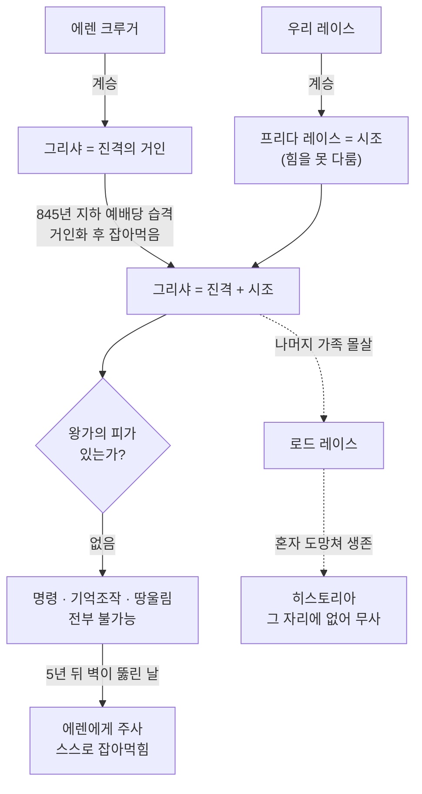

> 지성 거인은 **잡아먹으면 계승**됩니다. 이미 거인을 가진 사람이 먹으면 **둘 다** 갖게 되고요. 그래서 그리샤 = 진격 + 시조가 됩니다. 에렌이 라라 타이버를 먹고 전추까지 가진 것도 같은 원리입니다.

### 그런데 아무 쓸모가 없었다

**그리샤는 왕가의 피가 아니었습니다.** 시조를 손에 넣었지만 **명령도 기억 조작도 땅울림도 전부 불가능**했습니다.

빼앗기만 하고 쓰지 못한 채 5년을 보내다, 벽이 뚫린 날 **에렌에게 주사를 놓고 잡아먹히는 쪽**을 택합니다. 그리고 그 에렌도 결국 **지크의 왕가 피가 필요**했습니다.

### 위치

- 예배당 습격 — 시즌 3 Part 2 그리샤 회상편 + **원작 121화**(에렌의 개입 시점)
- 프리다와 히스토리아 — 시즌 3 Part 1 로드 레이스 편

---

## Q. 다이나가 카를라를 먹은 게 에렌의 의지라는 단서는 어디에 나와?

**원작 139화(최종화)에서 에렌이 아르민에게 직접 말합니다.** 추측이 아니라 본인 입으로 나오는 대사입니다.

### 직접 단서 — 139화

길에서 아르민과 마주 앉은 장면입니다. 에렌이 **"그날 어머니를 죽인 건 나"** 라는 취지로 고백하고, **다이나의 거인 옆에 서 있는 에렌**의 컷이 함께 제시됩니다.

그리고 이유를 말합니다. 여기가 핵심입니다.

> 다이나의 거인은 원래 **베르톨트**를 잡아먹으려던 참이었습니다. 에렌이 방향을 어머니 쪽으로 **틀었습니다.**

**베르톨트가 죽으면 안 됐기 때문**입니다.

```
베르톨트가 살아야
  → 초대형 거인이 아르민에게 계승됨
  → 아르민이 있어야 에렌의 계획이 성립
```

즉 **어머니를 희생시켜 베르톨트를 살린 것**입니다.

### 능력적 근거 — 시즌 2 최종화

"에렌이 다이나를 조종할 수 있다"는 건 **이미 시즌 2에서 증명돼 있습니다.** 에렌이 다이나의 거인을 때리는 순간 **좌표가 발동**하고, 주변 무지성 거인들이 몰려와 다이나를 덮칩니다. 작품이 **"에렌 → 다이나 명령 가능"** 을 몇 년 먼저 깔아둔 셈입니다.

### 연출적 단서 — 시즌 1

- 미소짓는 거인이 **한네스를 지나치고** 카를라만 콕 집어서 옴 — 무지성 거인답지 않은 **목적 있는 행동**
- 1화 첫 장면, 에렌이 울며 깨어나는 **"긴 꿈"**

### 다만 '의지'라는 말은 조심해야 한다

에렌이 **복수심으로** 그렇게 만든 것은 아닙니다. 그는 **이미 본 광경을 재현했을 뿐**이라고 말하고, 왜 그랬는지 **본인도 모르겠다**며 웁니다. 선택인지 정해진 것인지 **작품은 끝까지 답을 주지 않습니다.**

---

## Q. 에렌의 그 기억은 언제 인식되는 거야? 왕가 피와 접촉할 때면 다이나나 지크 때 돌아왔겠네? 시즌 1 첫 장면은 막연히 떠올린 건가?

**트리거는 "왕가의 피와의 접촉"이 맞습니다.** 다만 접촉마다 **열리는 정도가 다릅니다.**

### 세 번의 접촉, 세 가지 결과

| 접촉 상대 | 상태 | 결과 |
|---|---|---|
| **다이나** (시즌 2 최종화) | 왕가 피 · **무지성 거인** | **좌표만 순간 발동** — 거인들을 명령했지만 본인은 영문 모름. 기억 유입 없음 |
| **히스토리아** (원작 90화) | 왕가 피 · **인간** | **기억 일부 유입** — 그리샤의 레이스 예배당 장면 |
| **지크** (원작 120화) | 왕가 피 · **거인 상태** | **길 완전 진입** — 과거·미래 전부 |

다이나 때 기억이 안 돌아온 건 **다이나가 무지성이었기 때문**입니다. 명령 통로는 열렸지만 기억을 건네줄 의식이 없었습니다.

### 90화가 결정적이다

시가신나 탈환 후 **전사자 장례식**에서 에렌이 **히스토리아의 손을 잡습니다.** 그 순간 그리샤의 기억 — **예배당 학살** 장면이 흘러들어옵니다.

> **시즌 4의 에렌이 딴사람처럼 보이는 이유가 여기 있습니다.**

이때부터 에렌은 혼자 계획하고, 친구들에게 말하지 않고, 어두워집니다. 시즌 3 마지막 바다에서의 *"저놈들을 다 죽이면"* 도 이 접촉 **이후**입니다. 연기가 아니라 **정말 다른 것을 보고 있는 사람**이 된 것입니다.

### 시즌 1 첫 장면은 막연한 것이 아니다

**진짜 유입**입니다. 다만 통로가 다릅니다.

그때 에렌은 **아직 거인을 갖고 있지 않습니다** (10살, 벽이 뚫리기 직전). "진격의 거인 능력"으로는 설명이 안 됩니다. 설명은 **길**입니다.

> **모든 유미르의 백성은 길로 연결돼 있습니다.** 시조를 가진 미래의 에렌은 **누구에게든** 보낼 수 있습니다 — 크루거에게도, 그리샤에게도, **어린 자기 자신에게도.**

울면서 깨어나 *"긴 꿈을 꾼 것 같아"* 라고 한 그 장면은 **최종화의 광경**입니다. 1화와 139화가 같은 장면인 셈입니다.

### 정리 — '돌아온다'가 아니라 '흘러든다'

**본 시점과 이해한 시점이 다릅니다.**

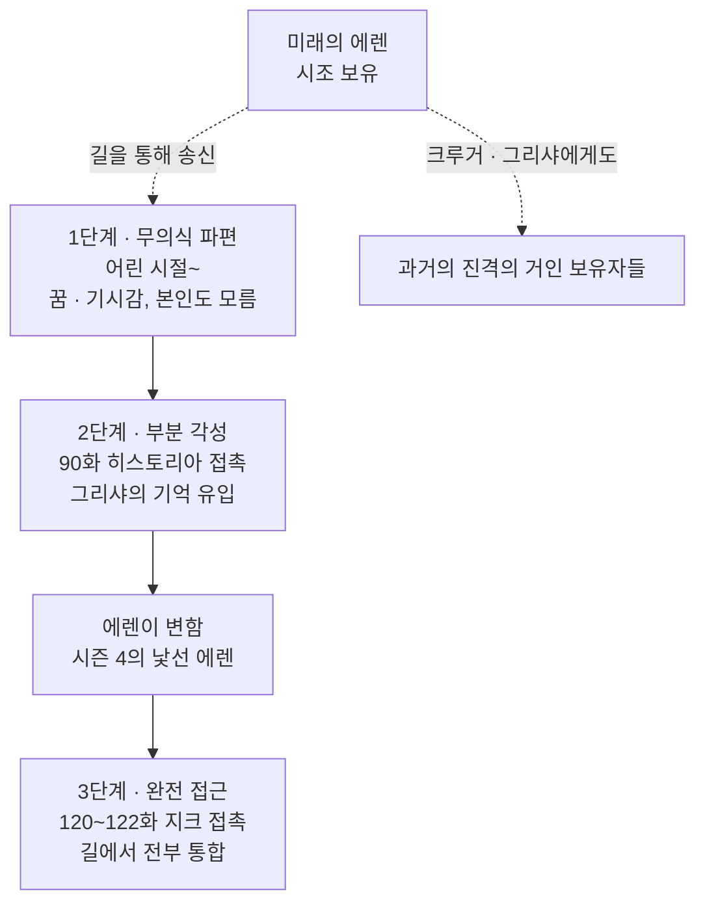

에렌이 계속 **"왜 그랬는지 모르겠다"** 고 하는 이유도 여기 있습니다. 그는 **이해하기 전에 이미 따라가고 있었습니다.**

### 위치

- 히스토리아 접촉 — **원작 90화** (시즌 3 Part 2 무렵), 무엇을 봤는지는 **파이널 시즌 Part 2**에서 재현
- 다이나 접촉 — **시즌 2 최종화**
- 지크 접촉 — **원작 120화**

---

## Q. 왜 지크와 접촉할 때만 길에 완전 진입해? 지크가 모든 기억을 갖고 있었어? 히스토리아는 예배당에 없었는데 왜 그 장면이 보여?

오해 하나만 걷어내면 전부 풀립니다.

> **접촉한 상대는 '기억 저장소'가 아니라 '열쇠'입니다.**

히스토리아도 지크도 기억을 **준 것이 아닙니다.** 둘 다 **문을 여는 조건**이었을 뿐입니다.

### 기억은 사람이 아니라 '길'에 있다

- **길(Path)** = 모든 유미르의 백성이 연결된 시공간 밖 공간, 중심에 유미르
- 거기에 **과거·현재·미래 모든 엘디아인의 기억**이 있음
- 접근 열쇠 = **시조 + 왕가의 피**

에렌은 시조를 가졌지만 **왕가의 피가 없습니다.** 혼자서는 문을 못 엽니다.

### 히스토리아 — 없었어도 상관없다

에렌이 본 기억은 **원래 에렌이 갖고 있던 것**입니다. 그리샤에게 거인을 계승받을 때 **기억도 같이 받았고**, 다만 **잠겨 있었습니다.**

```
에렌 안에 이미 있음 (그리샤에게서 계승)
  → 왕가 피가 없어서 잠김
  → 히스토리아의 손 = 열쇠
  → 잠금 해제 → 예배당 장면이 떠오름
```

히스토리아는 **기억의 출처가 아니라 스위치**였습니다.

> 왜 하필 예배당 장면이었나 — 작품이 엄밀한 규칙을 주지는 않습니다. 다만 **접촉한 상대(레이스 가문)와 직결된 기억**이 열린 것으로 보는 것이 자연스럽습니다. 히스토리아의 손을 잡은 순간 **그녀의 가족을 몰살한 기억**이 떠오른 것입니다.

### 지크도 기억을 갖고 있지 않았다

지크가 원래 가진 것은 **크사버의 기억** 정도입니다. 그리샤의 기억은 지크 것도 아니었습니다.

차이는 **문이 열린 정도**입니다.

| 접촉 | 상대 상태 | 열린 정도 |
|---|---|---|
| 다이나 | **무지성** 거인 | **명령 회선만** — 의식이 없어 기억을 건넬 수 없음 |
| 히스토리아 | 인간 | **문틈** — 관련 기억 한 조각 |
| 지크 | **지성 있는 왕족 + 거인 상태** | **문이 활짝** — 의식째로 길에 진입 |

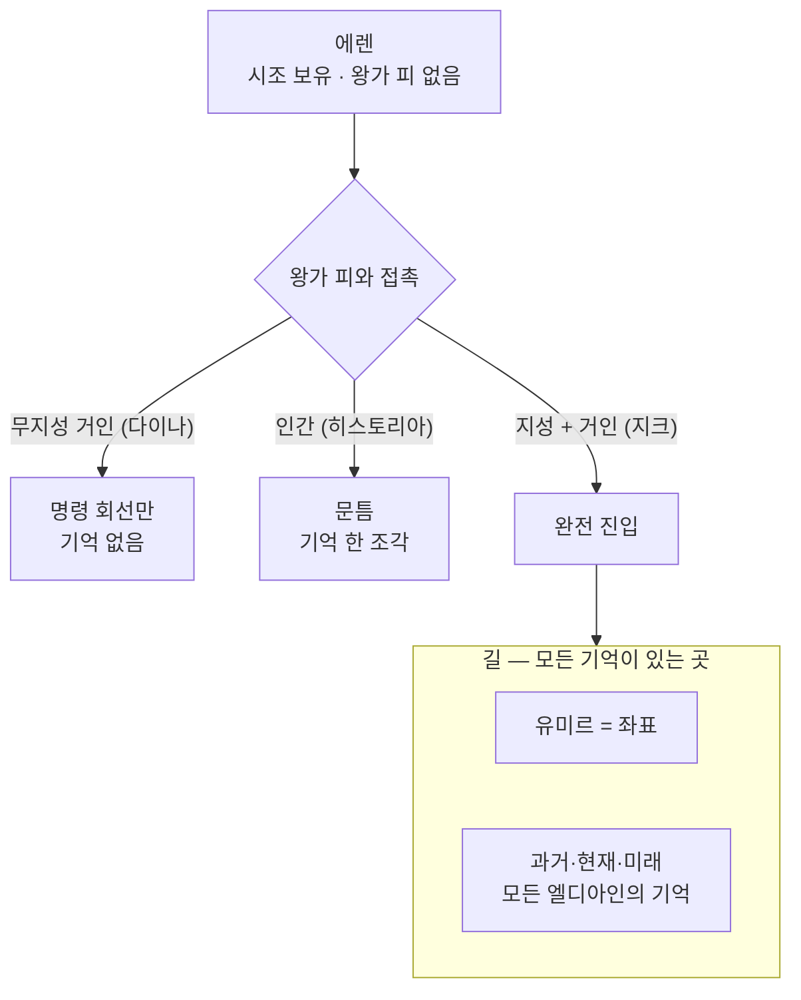

지크와의 접촉만 **시조 발동 조건을 완전히 충족**했습니다. 그러니 기억이 새어나오는 수준이 아니라 **두 사람이 통째로 길 안으로 들어갔고**, 일단 들어가면 **길에 있는 모든 기억**에 접근할 수 있습니다.

### 그 기억들은 지크가 골라서 보여준 것

길에 들어간 직후 **통제권은 지크에게 있었습니다.** 왕가의 피가 있으니까요.

그래서 120~121화에서 에렌이 본 그리샤의 기억들은 **지크가 선별해서 보여준 것**입니다. 목적은 **"아버지가 너를 세뇌한 거다, 너도 피해자다"** 라는 설득이었습니다.

그런데 보여주다가 **정반대가 드러납니다** — 그리샤를 움직인 것이 **미래의 에렌**이었다는 것. 지크가 자기 손으로 판을 뒤집은 셈입니다.

그 뒤 에렌이 좌표의 **유미르에게 직접 말을 걸어** 통제권을 가져오고, 122화 끝에서 시조로 각성합니다.

### 한 줄 정리

**왕족은 문고리고, 기억은 문 너머에 있습니다.** 문고리를 얼마나 세게 돌렸느냐가 다이나·히스토리아·지크의 차이입니다.
